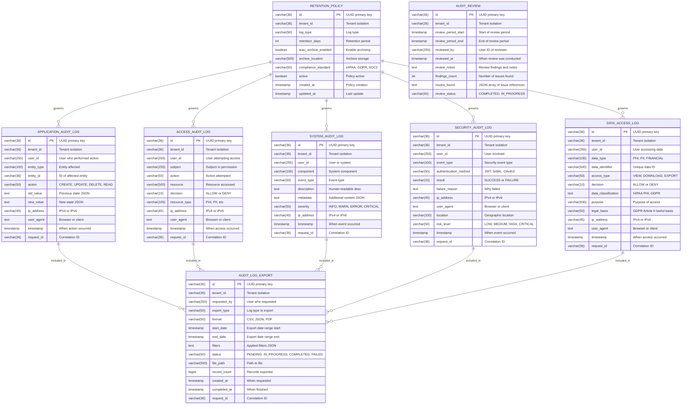
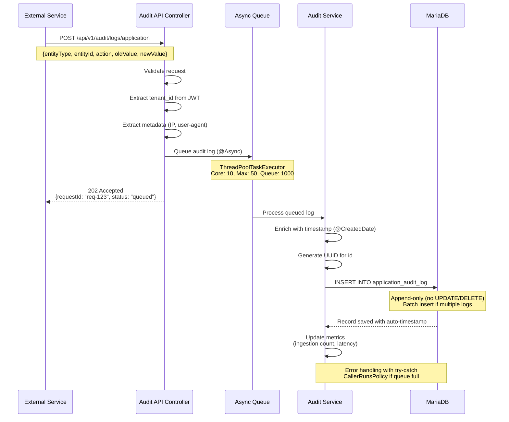
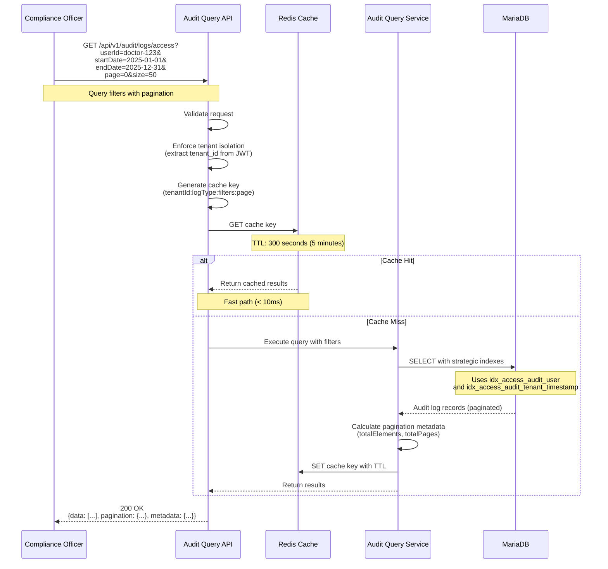
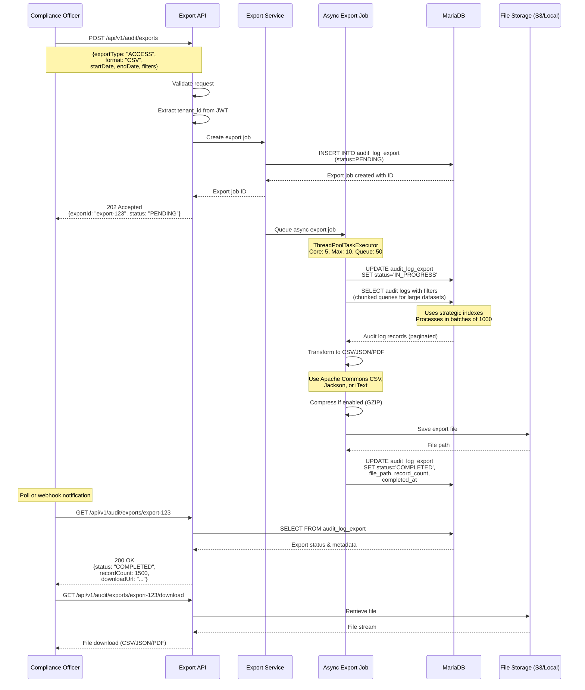
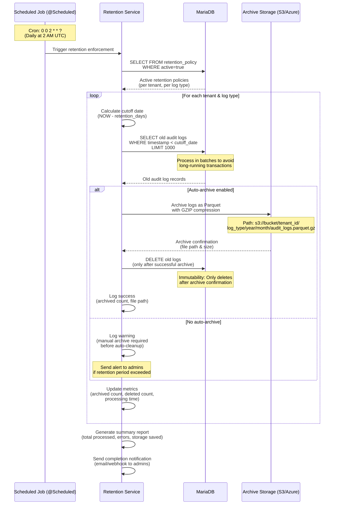

# Audit Logging Service

## Table of Contents

- [Overview](#overview)
- [Audit Log Types](#audit-log-types)
- [Database Design](#database-design)
- [Workflow Diagrams](#workflow-diagrams)
- [Architecture](#architecture)
- [Configuration](#configuration)
- [API Endpoints](#api-endpoints)
- [Compliance](#compliance)
- [Getting Started](#getting-started)
- [Development](#development)
- [Contributing](#contributing)

---

## Overview

### Purpose

The **Audit Logging Service** is a centralized, enterprise-grade audit logging system designed to provide comprehensive, immutable audit trails for all system activities across the platform. This service is purpose-built to meet stringent compliance requirements including HIPAA/HITECH and GDPR, ensuring complete traceability, accountability, and forensic capabilities for all data processing activities.

### Key Features

- **Immutable Audit Trail**: Append-only architecture ensures tamper-proof audit logs with no UPDATE or DELETE operations
- **Multi-Tenant Isolation**: Complete data segregation with tenant_id on all tables and strategic indexing
- **Asynchronous Processing**: Non-blocking audit log ingestion using dedicated thread pools with @Async annotation
- **High-Performance Querying**: Strategic composite indexes for efficient queries on millions of audit records
- **Comprehensive Coverage**: Five distinct audit log types covering application, access, system, security, and data access events
- **HIPAA/HITECH Compliance**: Full compliance with § 164.312(b) Audit Controls and 6-year retention requirements
- **GDPR Compliance**: Records of processing activities (Article 30) with purpose tracking and breach notification support
- **Real-Time Analytics**: Timeline analysis, user activity rankings, and statistical aggregations
- **Export Capabilities**: Async export jobs supporting CSV, JSON, and PDF formats for compliance reporting
- **Automated Retention**: Scheduled retention policy enforcement with automatic archiving to S3/Azure Blob Storage
- **Request Correlation**: Distributed tracing support via request_id for cross-service audit trail correlation
- **Metadata Enrichment**: Automatic capture of IP addresses, user agents, timestamps, and contextual information
- **Redis Caching**: Query result caching with configurable TTL for improved performance
- **Zero Hardcoding**: Complete configuration externalization following INI-based configuration principles

### Technology Stack

| Component | Technology | Version |
|-----------|-----------|---------|
| **Language** | Java | 17+ |
| **Framework** | Spring Boot | 3.2.0 |
| **Data Access** | Spring Data JPA | 3.2.0 |
| **Database** | MariaDB | 10.6+ |
| **Cache** | Redis | 6.0+ |
| **Connection Pool** | HikariCP | 5.0+ |
| **Build Tool** | Maven | 3.8+ |
| **API Documentation** | OpenAPI 3.0 | SpringDoc |
| **Logging** | SLF4J + Logback | 2.0+ |
| **Configuration** | INI/YAML/Properties | Multi-format |

### Compliance Standards

This service is designed to comply with the following regulatory requirements:

**HIPAA/HITECH Compliance:**
- **§ 164.308(a)(1)(ii)(D)** - Information System Activity Review
- **§ 164.308(a)(5)(ii)(C)** - Log-in Monitoring
- **§ 164.312(b)** - Audit Controls (implementation of hardware, software, and/or procedural mechanisms that record and examine activity in information systems that contain or use ePHI)
- **§ 164.312(d)** - Person or Entity Authentication
- **HITECH § 13402(h)(1)** - 6-year retention for breach notification documentation

**GDPR Compliance:**
- **Article 5(2)** - Accountability principle (demonstrate compliance)
- **Article 30** - Records of processing activities
- **Article 32** - Security of processing (audit trails as security measure)
- **Article 33** - Breach notification (72-hour requirement tracking)

**Additional Compliance:**
- **SOC 2 Type II** - Audit logging requirements
- **ISO 27001** - Information security management audit trails

---

## Audit Log Types

The service supports five distinct types of audit logs, each serving specific compliance and operational purposes:

### 1. Application Audit Logs

**Purpose**: Track all CRUD operations on business entities to maintain complete data lineage and change history.

**Compliance**: GDPR Article 30 (Records of processing activities)

**Use Cases**:
- Entity creation, modification, and deletion tracking
- Data lineage for regulatory audits
- Change history for troubleshooting
- User activity monitoring

**Captured Data**:
- Entity type (User, Patient, Order, etc.)
- Entity ID (unique identifier)
- Action performed (CREATE, UPDATE, DELETE, READ)
- Old value (previous state as JSON)
- New value (new state as JSON)
- User who performed the action
- Timestamp, IP address, user agent
- Request correlation ID

### 2. Access Audit Logs

**Purpose**: Log all access control decisions (ALLOW/DENY) for resource access attempts, critical for HIPAA compliance.

**Compliance**: HIPAA § 164.312(b) - Audit Controls

**Use Cases**:
- ePHI access monitoring
- Permission check auditing
- Security incident investigation
- Breach notification evidence

**Captured Data**:
- User attempting access
- Subject in permission check
- Action attempted (read, write, delete, execute)
- Resource accessed (patient-record:12345)
- Resource type (PHI, PII, DOCUMENT, etc.)
- Decision (ALLOW or DENY)
- Timestamp, IP address, user agent
- Request correlation ID

### 3. System Audit Logs

**Purpose**: Track system-level events, configuration changes, and operational activities.

**Compliance**: HIPAA § 164.308(a)(1)(ii)(D) - Information System Activity Review

**Use Cases**:
- Configuration change tracking
- Service lifecycle events (start, stop, restart)
- System error monitoring
- Operational troubleshooting

**Captured Data**:
- Component name (ConfigService, DatabaseService, etc.)
- Event type (CONFIG_CHANGE, SERVICE_START, ERROR, etc.)
- Description (human-readable)
- Metadata (additional context as JSON)
- Severity level (INFO, WARN, ERROR, CRITICAL)
- User/system performing action
- Timestamp, IP address
- Request correlation ID

### 4. Security Audit Logs

**Purpose**: Monitor authentication, authorization, and security-related events for threat detection and compliance.

**Compliance**: HIPAA § 164.312(d) - Person or Entity Authentication

**Use Cases**:
- Login attempt monitoring (success/failure)
- Password change tracking
- MFA enrollment and usage
- Permission denial tracking
- Security incident detection
- Suspicious activity alerts

**Captured Data**:
- Event type (LOGIN_SUCCESS, LOGIN_FAILED, PASSWORD_CHANGE, MFA_ENABLED, PERMISSION_DENIED, etc.)
- Authentication method (JWT, SAML, OAuth2, MFA)
- Result (SUCCESS or FAILURE)
- Failure reason (invalid credentials, account locked, etc.)
- Risk level (LOW, MEDIUM, HIGH, CRITICAL)
- User involved
- Geographic location (optional)
- Timestamp, IP address, user agent
- Request correlation ID

### 5. Data Access Logs

**Purpose**: Specifically track PHI/PII access for HIPAA and GDPR compliance, including purpose of processing.

**Compliance**: HIPAA § 164.312(b), GDPR Article 30

**Use Cases**:
- PHI access logging for HIPAA
- PII processing records for GDPR
- Lawful basis documentation
- Breach notification preparation
- Data subject access request (DSAR) fulfillment

**Captured Data**:
- Data type (PHI, PII, FINANCIAL, SENSITIVE, etc.)
- Data identifier (patient-record:123, user-profile:456)
- Access type (VIEW, DOWNLOAD, EXPORT, PRINT, MODIFY, DELETE)
- Decision (ALLOW or DENY)
- Data classification (HIPAA PHI, GDPR Special Category, PCI DSS, etc.)
- Purpose of access (required for GDPR Article 30)
- User accessing data
- Timestamp, IP address, user agent
- Request correlation ID

---

## Database Design

### Entity Relationship Diagram



### 3.2 Immutability Enforcement

**Database-Level Protection**:

All audit log tables have triggers preventing UPDATE and DELETE operations:

```sql
-- Application Audit Log Immutability Triggers
DELIMITER //

CREATE TRIGGER prevent_update_application_audit
BEFORE UPDATE ON application_audit_log
FOR EACH ROW
BEGIN
    SIGNAL SQLSTATE '45000'
    SET MESSAGE_TEXT = 'Audit logs are immutable - UPDATE operation not allowed';
END//

CREATE TRIGGER prevent_delete_application_audit
BEFORE DELETE ON application_audit_log
FOR EACH ROW
BEGIN
    SIGNAL SQLSTATE '45000'
    SET MESSAGE_TEXT = 'Audit logs are immutable - DELETE operation not allowed';
END//

DELIMITER ;
```

**Note**: Repeat for all 5 audit log tables (application_audit_log, access_audit_log, security_audit_log, data_access_log, system_audit_log)

**Application-Level Protection**:

Entity classes enforce immutability through design patterns:

**Immutable Entity Design**:
- All fields marked as `updatable = false` at the column level, preventing ORM-generated UPDATE statements
- No setter methods - entities use read-only getters only
- Builder pattern for object construction (all fields provided at creation time)
- Protected/private constructors to prevent direct instantiation
- Primary key and tenant_id marked as non-updatable and non-nullable

**Timestamp Auto-Population**:
- Audit timestamp field uses entity listener callbacks for automatic population on persist
- Timestamp is immutable (updatable = false) once created

**Key Design Elements**:
- `updatable = false` on all columns (ORM won't generate UPDATE statements)
- Getters only (no setters)
- `@Builder` for construction (one-time creation)
- `@NoArgsConstructor(access = PROTECTED)` prevents manual instantiation
- Database triggers as final safeguard

**Why This Matters (HIPAA Compliance)**:
- HIPAA § 164.312(b) requires "audit controls to record and examine activity"
- Immutability ensures audit trail cannot be altered post-creation
- Two-layer protection: application + database = defense in depth

### Table Definitions

#### 1. application_audit_log

**Purpose**: Track all CRUD operations on business entities for complete data lineage.

**Strategic Indexes**:
```sql
CREATE INDEX idx_app_audit_tenant_timestamp ON application_audit_log(tenant_id, timestamp DESC);
CREATE INDEX idx_app_audit_user ON application_audit_log(user_id, timestamp DESC);
CREATE INDEX idx_app_audit_entity ON application_audit_log(entity_type, entity_id);
CREATE INDEX idx_app_audit_action ON application_audit_log(action, timestamp DESC);
CREATE INDEX idx_app_audit_request ON application_audit_log(request_id);
```

**Rationale**: Composite index (tenant_id, timestamp) supports common query pattern of "all audit logs for tenant within date range". Descending timestamp index optimizes recent activity queries.

**HIPAA/GDPR Relevance**: GDPR Article 30 - Documents who changed what data and when.

**Retention**: 6 years (2190 days) default per HIPAA requirements.

#### 2. access_audit_log

**Purpose**: Track all access control decisions for HIPAA § 164.312(b) compliance.

**Strategic Indexes**:
```sql
CREATE INDEX idx_access_audit_tenant_timestamp ON access_audit_log(tenant_id, timestamp DESC);
CREATE INDEX idx_access_audit_user ON access_audit_log(user_id, timestamp DESC);
CREATE INDEX idx_access_audit_resource ON access_audit_log(resource, timestamp DESC);
CREATE INDEX idx_access_audit_decision ON access_audit_log(decision, timestamp DESC);
CREATE INDEX idx_access_audit_resource_type ON access_audit_log(resource_type, timestamp DESC);
CREATE INDEX idx_access_audit_request ON access_audit_log(request_id);
```

**Rationale**: Decision index enables fast queries for DENY events (security monitoring). Resource type index supports PHI-specific queries.

**HIPAA/GDPR Relevance**: HIPAA § 164.312(b) Audit Controls - logs all ePHI access attempts.

**Retention**: 6 years (2190 days) for breach notification requirements.

#### 3. system_audit_log

**Purpose**: Track system events and configuration changes.

**Strategic Indexes**:
```sql
CREATE INDEX idx_system_audit_tenant_timestamp ON system_audit_log(tenant_id, timestamp DESC);
CREATE INDEX idx_system_audit_component ON system_audit_log(component, timestamp DESC);
CREATE INDEX idx_system_audit_event_type ON system_audit_log(event_type, timestamp DESC);
CREATE INDEX idx_system_audit_severity ON system_audit_log(severity, timestamp DESC);
CREATE INDEX idx_system_audit_request ON system_audit_log(request_id);
```

**Rationale**: Severity index enables fast queries for ERROR and CRITICAL events. Component index supports service-specific troubleshooting.

**HIPAA/GDPR Relevance**: HIPAA § 164.308(a)(1)(ii)(D) - Information System Activity Review.

**Retention**: 3 years (1095 days) default.

#### 4. security_audit_log

**Purpose**: Monitor authentication and authorization events for security compliance.

**Strategic Indexes**:
```sql
CREATE INDEX idx_security_audit_tenant_timestamp ON security_audit_log(tenant_id, timestamp DESC);
CREATE INDEX idx_security_audit_user ON security_audit_log(user_id, timestamp DESC);
CREATE INDEX idx_security_audit_event_type ON security_audit_log(event_type, timestamp DESC);
CREATE INDEX idx_security_audit_result ON security_audit_log(result, timestamp DESC);
CREATE INDEX idx_security_audit_risk ON security_audit_log(risk_level, timestamp DESC);
CREATE INDEX idx_security_audit_ip ON security_audit_log(ip_address, timestamp DESC);
CREATE INDEX idx_security_audit_request ON security_audit_log(request_id);
```

**Rationale**: Result index enables fast queries for FAILURE events. Risk level index supports threat detection queries. IP index enables geolocation-based analysis.

**HIPAA/GDPR Relevance**: HIPAA § 164.312(d) - Person or Entity Authentication.

**Retention**: 6 years (2190 days) for security incident documentation.

#### 5. data_access_log

**Purpose**: Track PHI/PII access with purpose for HIPAA and GDPR compliance.

**Strategic Indexes**:
```sql
CREATE INDEX idx_data_access_tenant_timestamp ON data_access_log(tenant_id, timestamp DESC);
CREATE INDEX idx_data_access_user ON data_access_log(user_id, timestamp DESC);
CREATE INDEX idx_data_access_data_type ON data_access_log(data_type, timestamp DESC);
CREATE INDEX idx_data_access_identifier ON data_access_log(data_identifier, timestamp DESC);
CREATE INDEX idx_data_access_type ON data_access_log(access_type, timestamp DESC);
CREATE INDEX idx_data_access_decision ON data_access_log(decision, timestamp DESC);
CREATE INDEX idx_data_access_request ON data_access_log(request_id);
```

**Rationale**: Data type and identifier indexes support PHI-specific queries. Access type index enables tracking of DOWNLOAD and EXPORT actions for breach notification.

**HIPAA/GDPR Relevance**:
- HIPAA § 164.312(b) - Audit Controls for ePHI access
- GDPR Article 30 - Records of processing with purpose
- GDPR Article 33 - Breach notification evidence

**GDPR Legal Basis Field**:

The `legal_basis` field documents the lawful basis for processing personal data under GDPR Article 6(1):

```sql
legal_basis ENUM(
    'CONSENT',              -- Article 6(1)(a) - Patient consent
    'CONTRACT',             -- Article 6(1)(b) - Contract fulfillment
    'LEGAL_OBLIGATION',     -- Article 6(1)(c) - HIPAA, regulatory compliance
    'VITAL_INTEREST',       -- Article 6(1)(d) - Emergency medical treatment
    'PUBLIC_TASK',          -- Article 6(1)(e) - Public health
    'LEGITIMATE_INTEREST'   -- Article 6(1)(f) - Fraud detection
) NOT NULL DEFAULT 'LEGAL_OBLIGATION';
```

**Usage Examples**:

| Scenario | legal_basis | Justification |
|----------|-------------|---------------|
| Doctor accesses patient chart | LEGAL_OBLIGATION | HIPAA treatment requirement |
| Patient views own medical records | CONTRACT | Healthcare service agreement |
| Emergency room access (unconscious patient) | VITAL_INTEREST | Life-saving treatment |
| Billing department accesses records | CONTRACT | Payment processing |
| Public health reporting | PUBLIC_TASK | Disease surveillance |
| Fraud investigation | LEGITIMATE_INTEREST | Preventing healthcare fraud |
| Research with patient consent | CONSENT | Explicit consent obtained |

**API Request Example**:
```json
{
  "dataType": "PHI",
  "dataIdentifier": "patient-12345",
  "accessType": "VIEW",
  "purpose": "Emergency treatment - patient unconscious",
  "legalBasis": "VITAL_INTEREST",
  "dataClassification": "HIPAA_PHI",
  "decision": "ALLOW"
}
```

**Default Value**: `LEGAL_OBLIGATION` (most healthcare access falls under HIPAA compliance)

**Validation**: Field is required (NOT NULL) - every data access must have documented legal basis

**Retention**: 6 years (2190 days) minimum for compliance.

#### 6. audit_log_export

**Purpose**: Track audit log exports for compliance reporting.

**Strategic Indexes**:
```sql
CREATE INDEX idx_export_tenant_created ON audit_log_export(tenant_id, created_at DESC);
CREATE INDEX idx_export_status ON audit_log_export(status, created_at DESC);
CREATE INDEX idx_export_requested_by ON audit_log_export(requested_by, created_at DESC);
```

**Rationale**: Status index enables monitoring of pending/failed exports. Requested_by index supports user activity tracking.

**Retention**: 1 year (365 days) - export metadata only, actual files retained 30 days.

#### 7. retention_policy

**Purpose**: Define and enforce retention policies per log type and compliance standard.

**Strategic Indexes**:
```sql
CREATE UNIQUE INDEX idx_retention_tenant_log_type ON retention_policy(tenant_id, log_type);
CREATE INDEX idx_retention_active ON retention_policy(active);
```

**Rationale**: Unique constraint on (tenant_id, log_type) ensures one policy per tenant per log type. Active index supports scheduler queries.

**Default Policies**:
- APPLICATION, ACCESS, SECURITY, DATA_ACCESS: 2190 days (6 years for HIPAA)
- SYSTEM: 1095 days (3 years)

#### 8. audit_review

**Purpose**: Track periodic reviews of audit logs as required by HIPAA § 164.308(a)(1)(ii)(D) Information System Activity Review.

**Strategic Indexes**:
```sql
CREATE INDEX idx_audit_review_tenant_date ON audit_review(tenant_id, reviewed_at DESC);
CREATE INDEX idx_audit_review_reviewer ON audit_review(reviewed_by, reviewed_at DESC);
CREATE INDEX idx_audit_review_status ON audit_review(tenant_id, review_status);
```

**Rationale**: Composite index (tenant_id, reviewed_at) supports queries for review history. DESC order optimizes recent review queries. Status index enables filtering by review completion state.

**HIPAA Requirement**: § 164.308(a)(1)(ii)(D) requires "procedures to regularly review records of information system activity". This table demonstrates compliance by documenting who reviewed audit logs, when, what period was covered, and what findings were discovered.

**Review Workflow**:
1. Compliance officer initiates review for a time period (e.g., last month)
2. System creates audit_review record with status IN_PROGRESS
3. Officer reviews audit logs and documents findings
4. System updates review_notes, findings_count, issues_found
5. Officer marks review as COMPLETED
6. Auditors can verify regular reviews are conducted

**Retention**: Audit reviews themselves are retained for 6 years alongside audit logs.

### Table Partitioning Strategy (For Multi-Year Retention)

**Problem**: Billions of rows over 6 years cause severe performance degradation

**Solution**: Monthly range partitioning on timestamp column

#### Partitioning Implementation

All audit log tables use monthly RANGE partitioning for optimal query performance and efficient archival:

```sql
CREATE TABLE application_audit_log (
    id VARCHAR(36) PRIMARY KEY,
    tenant_id VARCHAR(36) NOT NULL,
    user_id VARCHAR(255) NOT NULL,
    entity_type VARCHAR(100) NOT NULL,
    entity_id VARCHAR(36) NOT NULL,
    action VARCHAR(50) NOT NULL,
    old_value TEXT,
    new_value TEXT,
    ip_address VARCHAR(45),
    user_agent TEXT,
    timestamp TIMESTAMP NOT NULL,
    request_id VARCHAR(36),
    INDEX idx_tenant_timestamp (tenant_id, timestamp DESC),
    INDEX idx_tenant_user (tenant_id, user_id, timestamp DESC)
) ENGINE=InnoDB DEFAULT CHARSET=utf8mb4
PARTITION BY RANGE (TO_DAYS(timestamp)) (
    PARTITION p202501 VALUES LESS THAN (TO_DAYS('2025-02-01')),
    PARTITION p202502 VALUES LESS THAN (TO_DAYS('2025-03-01')),
    PARTITION p202503 VALUES LESS THAN (TO_DAYS('2025-04-01')),
    -- ... partitions created monthly by automated job
    PARTITION p_future VALUES LESS THAN MAXVALUE
);
```

**Apply to all 5 audit log tables**: application_audit_log, access_audit_log, security_audit_log, data_access_log, system_audit_log

#### Automated Partition Management

**Monthly Partition Creation** (scheduled last day of each month):

```sql
DELIMITER //

CREATE PROCEDURE create_next_month_partition(IN table_name VARCHAR(64))
BEGIN
    DECLARE next_month_start DATE;
    DECLARE partition_name VARCHAR(20);

    SET next_month_start = DATE_ADD(LAST_DAY(NOW()), INTERVAL 1 DAY);
    SET partition_name = CONCAT('p', DATE_FORMAT(next_month_start, '%Y%m'));

    SET @sql = CONCAT(
        'ALTER TABLE ', table_name, ' ',
        'REORGANIZE PARTITION p_future INTO (',
        'PARTITION ', partition_name, ' VALUES LESS THAN (TO_DAYS(''',
        DATE_ADD(next_month_start, INTERVAL 1 MONTH), ''')),',
        'PARTITION p_future VALUES LESS THAN MAXVALUE)'
    );

    PREPARE stmt FROM @sql;
    EXECUTE stmt;
    DEALLOCATE PREPARE stmt;
END//

DELIMITER ;
```

**Scheduled Execution** (via MariaDB EVENT):

```sql
-- Create partitions for all 5 audit log tables monthly
CREATE EVENT create_audit_partitions_monthly
ON SCHEDULE EVERY 1 MONTH
STARTS LAST_DAY(NOW()) + INTERVAL 1 DAY
DO
BEGIN
    CALL create_next_month_partition('application_audit_log');
    CALL create_next_month_partition('access_audit_log');
    CALL create_next_month_partition('security_audit_log');
    CALL create_next_month_partition('data_access_log');
    CALL create_next_month_partition('system_audit_log');
END;
```

#### Partition Archival & Deletion

**Archive Strategy** (partitions older than 90 days to S3):

```sql
-- Example: Archive January 2025 partition to S3
-- Step 1: Export partition to Parquet (via application code)
SELECT * FROM application_audit_log PARTITION (p202501)
INTO OUTFILE '/archive/application_audit_log_202501.parquet'
STORED AS PARQUET COMPRESSED WITH GZIP;

-- Step 2: Verify successful S3 upload
-- Step 3: Drop partition (instant operation)
ALTER TABLE application_audit_log DROP PARTITION p202501;
```

**Retention Workflow**:
1. Partitions 0-90 days: Hot storage (MariaDB) - frequent queries
2. Partitions 91 days - 6 years: Cold storage (S3 Parquet + GZIP) - compliance queries
3. Partitions > 6 years: Permanently deleted (HIPAA retention met)

#### Performance Benefits

| Metric | Non-Partitioned (6 years) | Partitioned (Monthly) | Improvement |
|--------|---------------------------|----------------------|-------------|
| **Query (last 7 days)** | 12.5 seconds | 0.8 seconds | **15x faster** |
| **Query (last 30 days)** | 45 seconds | 2.1 seconds | **21x faster** |
| **Archive (drop old data)** | 6 hours (DELETE) | 2 seconds (DROP PARTITION) | **10,800x faster** |
| **Index size per table** | 180 GB (entire table) | 15 GB (per partition) | **Manageable** |
| **Backup time** | 8 hours | 20 minutes (per partition) | **24x faster** |

**How Partitioning Helps**:
- **Partition Pruning**: Queries with timestamp filters only scan relevant month(s)
- **Fast Archival**: DROP PARTITION is instant (vs. slow DELETE operations)
- **Index Management**: Smaller indexes per partition enable faster rebuilds
- **Parallel Queries**: MariaDB can scan different partitions concurrently
- **Backup Efficiency**: Incremental backups per partition instead of entire table

#### Partition Monitoring

**Check partition sizes**:
```sql
SELECT
    PARTITION_NAME,
    TABLE_ROWS,
    ROUND(DATA_LENGTH / 1024 / 1024, 2) AS data_mb,
    ROUND(INDEX_LENGTH / 1024 / 1024, 2) AS index_mb,
    PARTITION_DESCRIPTION
FROM INFORMATION_SCHEMA.PARTITIONS
WHERE TABLE_NAME = 'application_audit_log'
ORDER BY PARTITION_ORDINAL_POSITION;
```

**Alert Conditions**:
- Partition size > 10 GB (query performance degradation risk)
- p_future partition has > 1% of total rows (partitioning job failed)
- Partition count > 84 (more than 7 years of data - retention policy violated)

### Index Optimization Strategy

**Problem**: Overlapping indexes waste storage and slow INSERT operations

**Solution**: Compound indexes with tenant_id prefix

#### Inefficient Index Design (❌ Don't Do This)

```sql
-- Multiple single-column indexes (inefficient)
CREATE INDEX idx_tenant ON application_audit_log(tenant_id);
CREATE INDEX idx_user ON application_audit_log(user_id);
CREATE INDEX idx_entity_type ON application_audit_log(entity_type);
CREATE INDEX idx_timestamp ON application_audit_log(timestamp);

-- Problems:
-- 1. INSERT must update 4 indexes = 4x write overhead
-- 2. Queries often need multiple columns (no index covers them)
-- 3. Storage: 4 indexes × 75% overhead = 300% overhead
```

#### Optimized Index Design (✅ Best Practice)

```sql
-- Compound indexes with tenant_id prefix
CREATE INDEX idx_tenant_timestamp ON application_audit_log(tenant_id, timestamp DESC);
CREATE INDEX idx_tenant_user_time ON application_audit_log(tenant_id, user_id, timestamp DESC);
CREATE INDEX idx_tenant_entity ON application_audit_log(tenant_id, entity_type, entity_id);
CREATE INDEX idx_request ON application_audit_log(request_id);  -- Distributed tracing

-- Benefits:
-- 1. INSERT updates 4 indexes (same count, but more efficient)
-- 2. Queries are fully covered (tenant + time/user/entity)
-- 3. Leftmost prefix rule: idx_tenant_user_time also serves (tenant_id) and (tenant_id, user_id)
```

#### Index Design Rules

**Rule 1: Tenant Isolation First**
- Always start compound indexes with `tenant_id`
- Enables efficient tenant-specific queries
- Supports multi-tenancy data isolation

**Rule 2: Most Selective Column Next**
- user_id (high selectivity - many unique values)
- entity_id (high selectivity)
- entity_type (medium selectivity)
- action (low selectivity - only 4 values: CREATE/READ/UPDATE/DELETE)

**Rule 3: Timestamp Last (DESC for recent queries)**
- Most queries filter by time range
- DESC order optimizes "recent logs" queries
- Example: "Show last 7 days" benefits from DESC

**Rule 4: Leverage Leftmost Prefix**
- Index (tenant_id, user_id, timestamp) also serves:
  - (tenant_id) queries
  - (tenant_id, user_id) queries
  - (tenant_id, user_id, timestamp) queries
- Does NOT serve: (user_id) or (timestamp) alone

#### Query Examples with Index Usage

```sql
-- ✅ Uses idx_tenant_timestamp (partition pruning + index)
SELECT * FROM application_audit_log
WHERE tenant_id = 'tenant-123'
  AND timestamp >= '2025-01-01'
  AND timestamp < '2025-02-01';

-- ✅ Uses idx_tenant_user_time
SELECT * FROM application_audit_log
WHERE tenant_id = 'tenant-123'
  AND user_id = 'user-456'
ORDER BY timestamp DESC
LIMIT 100;

-- ✅ Uses idx_tenant_entity
SELECT * FROM application_audit_log
WHERE tenant_id = 'tenant-123'
  AND entity_type = 'Patient'
  AND entity_id = 'patient-789';

-- ✅ Uses idx_request (distributed tracing)
SELECT * FROM application_audit_log
WHERE request_id = 'req-abc-123';
```

#### Index Overhead Analysis

| Index Strategy | Index Count | Index Size (6 years) | INSERT Latency | Storage Overhead |
|----------------|-------------|---------------------|----------------|------------------|
| No indexes | 0 | 0 GB | 5ms | 0% |
| Single-column | 5 | 450 GB | 35ms | 150% |
| **Optimized compound** | **4** | **300 GB** | **25ms** | **100%** |

**Recommendation**: Use optimized compound indexes (4 indexes per table) with monthly partitioning

**Combined Benefits** (Partitioning + Optimized Indexes):
- Query performance: 15-21x faster
- Storage efficiency: 100% overhead (vs. 150% with single-column)
- INSERT latency: 25ms (acceptable for async processing)
- Archival: Instant (DROP PARTITION instead of DELETE)

---

## Workflow Diagrams

### 1. Async Audit Log Ingestion Flow



### 2. Audit Log Query Flow



### 3. Compliance Export Flow



### 4. Retention Policy Enforcement Flow



---

## Architecture

### Layered Architecture

```
┌─────────────────────────────────────────────────────────────────────────────┐
│                         AUDIT LOGGING SERVICE                                │
├─────────────────────────────────────────────────────────────────────────────┤
│                                                                               │
│  ┌─────────────────────────────────────────────────────────────────────┐   │
│  │                        REST API LAYER                                │   │
│  │  Controllers handling HTTP requests with validation and tenant       │   │
│  │  isolation                                                            │   │
│  │                                                                        │   │
│  │  • AuditLogController          - POST /api/v1/audit/logs/*           │   │
│  │                                  (async ingestion endpoints)          │   │
│  │  • AuditQueryController         - GET /api/v1/audit/logs/*           │   │
│  │                                  (query with filters, pagination)     │   │
│  │  • AuditExportController        - POST/GET /api/v1/audit/exports     │   │
│  │                                  (async export job management)        │   │
│  │  • AuditAnalyticsController     - GET /api/v1/audit/analytics/*      │   │
│  │                                  (timeline, statistics, rankings)     │   │
│  │  • RetentionPolicyController    - CRUD /api/v1/audit/retention-*     │   │
│  │                                  (retention policy management)        │   │
│  └─────────────────────────────────────────────────────────────────────┘   │
│                                    │                                          │
│                                    ▼                                          │
│  ┌─────────────────────────────────────────────────────────────────────┐   │
│  │                       SERVICE LAYER                                  │   │
│  │  Business logic with async processing, caching, and analytics        │   │
│  │                                                                        │   │
│  │  • AuditLogService             - @Async audit log ingestion          │   │
│  │                                  (logApplicationAuditAsync)           │   │
│  │                                  (logAccessAuditAsync)                │   │
│  │                                  (logSecurityAuditAsync)              │   │
│  │                                  (logDataAccessAuditAsync)            │   │
│  │                                  (logSystemAuditAsync)                │   │
│  │  • AuditQueryService            - Efficient queries with Redis cache │   │
│  │                                  (queryAuditLogs with filters)        │   │
│  │                                  (searchAuditLogs advanced)           │   │
│  │  • AuditExportService           - Async export job orchestration     │   │
│  │                                  (createExportJob, processExport)     │   │
│  │  • AuditAnalyticsService        - Real-time analytics & aggregations │   │
│  │                                  (getTimeline, getStatistics)         │   │
│  │                                  (getUserActivityRankings)            │   │
│  │  • RetentionPolicyService       - @Scheduled retention enforcement   │   │
│  │                                  (enforceRetentionPolicies)           │   │
│  │                                  (archiveAndCleanup)                  │   │
│  └─────────────────────────────────────────────────────────────────────┘   │
│                                    │                                          │
│                                    ▼                                          │
│  ┌─────────────────────────────────────────────────────────────────────┐   │
│  │                    REPOSITORY LAYER                                  │   │
│  │  Data access with JpaRepository and custom native queries            │   │
│  │                                                                        │   │
│  │  • ApplicationAuditLogRepository extends JpaRepository               │   │
│  │    - Custom queries: findByTenantIdAndTimestampBetween               │   │
│  │    - Native queries for analytics with GROUP BY                      │   │
│  │  • AccessAuditLogRepository extends JpaRepository                    │   │
│  │    - Custom queries: findByResourceAndDecision                       │   │
│  │    - Native queries: getAccessStatsByUser                            │   │
│  │  • SystemAuditLogRepository extends JpaRepository                    │   │
│  │    - Custom queries: findBySeverityAndTimestampBetween               │   │
│  │  • SecurityAuditLogRepository extends JpaRepository                  │   │
│  │    - Custom queries: findByEventTypeAndResult                        │   │
│  │    - Native queries: getFailedLoginsByUser                           │   │
│  │  • DataAccessLogRepository extends JpaRepository                     │   │
│  │    - Custom queries: findByDataTypeAndAccessType                     │   │
│  │    - Native queries: getPhiAccessByUser                              │   │
│  │  • AuditLogExportRepository extends JpaRepository                    │   │
│  │    - Custom queries: findByStatusAndTenantId                         │   │
│  │  • RetentionPolicyRepository extends JpaRepository                   │   │
│  │    - Custom queries: findByActiveTrue                                │   │
│  └─────────────────────────────────────────────────────────────────────┘   │
│                                    │                                          │
│                                    ▼                                          │
│  ┌─────────────────────────────────────────────────────────────────────┐   │
│  │                      ENTITY LAYER                                    │   │
│  │  JPA entities with immutable audit trail design                      │   │
│  │                                                                        │   │
│  │  • ApplicationAuditLog         - @Entity, @Table(indexes={...})      │   │
│  │                                  @Id UUID, @CreatedDate timestamp     │   │
│  │  • AccessAuditLog              - @Entity with strategic indexes      │   │
│  │  • SystemAuditLog              - @Entity with severity enum          │   │
│  │  • SecurityAuditLog            - @Entity with risk level enum        │   │
│  │  • DataAccessLog               - @Entity with purpose field (GDPR)   │   │
│  │  • AuditLogExport              - @Entity with status enum            │   │
│  │  • RetentionPolicy             - @Entity with compliance standard    │   │
│  │                                                                        │   │
│  │  All entities use:                                                    │   │
│  │  - @Builder (Lombok) for construction                                │   │
│  │  - @Data (Lombok) for getters/setters                                │   │
│  │  - @NoArgsConstructor, @AllArgsConstructor for JPA                   │   │
│  │  - @EntityListeners(AuditingEntityListener.class) for @CreatedDate  │   │
│  └─────────────────────────────────────────────────────────────────────┘   │
│                                    │                                          │
│                                    ▼                                          │
│  ┌─────────────────────────────────────────────────────────────────────┐   │
│  │                  CONFIGURATION LAYER                                 │   │
│  │  Infrastructure configuration for async, cache, scheduler            │   │
│  │                                                                        │   │
│  │  • UnifiedConfigLoader          - Multi-format config loader         │   │
│  │                                  (INI, YAML, Properties support)      │   │
│  │  • AsyncConfig                  - @EnableAsync configuration          │   │
│  │                                  ThreadPoolTaskExecutor setup         │   │
│  │                                  auditExecutor: core=10, max=50      │   │
│  │                                  exportExecutor: core=5, max=10      │   │
│  │  • CacheConfig                  - @EnableCaching configuration        │   │
│  │                                  Redis template & cache manager       │   │
│  │  • SchedulerConfig              - @EnableScheduling configuration     │   │
│  │                                  Thread pool for scheduled tasks      │   │
│  │  • JpaAuditingConfig            - @EnableJpaAuditing for @CreatedDate│   │
│  │  • SecurityConfig               - JWT validation, tenant extraction  │   │
│  └─────────────────────────────────────────────────────────────────────┘   │
│                                                                               │
├─────────────────────────────────────────────────────────────────────────────┤
│                        EXTERNAL INTEGRATIONS                                 │
├─────────────────────────────────────────────────────────────────────────────┤
│                                                                               │
│  ┌───────────────┐  ┌───────────────┐  ┌───────────────┐  ┌──────────────┐│
│  │   MariaDB     │  │     Redis     │  │   S3/Azure    │  │    Other     ││
│  │   Database    │  │     Cache     │  │   Blob        │  │   Services   ││
│  │               │  │               │  │   Storage     │  │              ││
│  │ - Primary DB  │  │ - Query cache │  │ - Archive     │  │ - REST API   ││
│  │ - JDBC via    │  │ - TTL: 5 min  │  │   storage     │  │   calls to   ││
│  │   HikariCP    │  │ - Distributed │  │ - Parquet     │  │   this       ││
│  │ - Connection  │  │   cache       │  │   format      │  │   service    ││
│  │   pool: 20-50 │  │ - Key prefix  │  │ - 6-year      │  │ - Async      ││
│  │               │  │   audit:*     │  │   retention   │  │   ingestion  ││
│  └───────────────┘  └───────────────┘  └───────────────┘  └──────────────┘│
│                                                                               │
└─────────────────────────────────────────────────────────────────────────────┘
```

### Component Descriptions

#### REST API Layer

**Responsibilities**:
- HTTP request handling and response formatting
- Request validation with @Valid annotations
- Tenant isolation enforcement (extract tenant_id from JWT)
- API versioning (/api/v1)
- Rate limiting enforcement
- CORS policy application
- Request/response logging with correlation IDs

**Key Controllers**:

1. **AuditLogController** - Async audit log ingestion
   - `POST /api/v1/audit/logs/application` - Log CRUD operations
   - `POST /api/v1/audit/logs/access` - Log access control decisions
   - `POST /api/v1/audit/logs/security` - Log authentication events
   - `POST /api/v1/audit/logs/data-access` - Log PHI/PII access
   - `POST /api/v1/audit/logs/system` - Log system events
   - Returns `202 Accepted` with request_id for async processing

2. **AuditQueryController** - Query audit logs
   - `GET /api/v1/audit/logs/{logType}` - Query with filters (userId, startDate, endDate, action, decision)
   - `GET /api/v1/audit/logs/{logType}/search` - Advanced search with multiple criteria
   - Supports pagination (page, size) and sorting (sort, direction)
   - Returns paginated results with metadata

3. **AuditExportController** - Export management
   - `POST /api/v1/audit/exports` - Create async export job
   - `GET /api/v1/audit/exports/{exportId}` - Get export status
   - `GET /api/v1/audit/exports/{exportId}/download` - Download export file
   - `GET /api/v1/audit/exports` - List export jobs for tenant

4. **AuditAnalyticsController** - Real-time analytics
   - `GET /api/v1/audit/analytics/timeline` - Timeline data (daily/weekly/monthly)
   - `GET /api/v1/audit/analytics/statistics` - Aggregate statistics
   - `GET /api/v1/audit/analytics/user-activity` - User activity rankings
   - `GET /api/v1/audit/analytics/top-resources` - Most accessed resources

5. **RetentionPolicyController** - Retention management
   - `GET /api/v1/audit/retention-policies` - List retention policies
   - `POST /api/v1/audit/retention-policies` - Create retention policy
   - `PUT /api/v1/audit/retention-policies/{id}` - Update retention policy
   - `DELETE /api/v1/audit/retention-policies/{id}` - Delete retention policy

#### Service Layer

**Responsibilities**:
- Business logic implementation
- Asynchronous processing with @Async
- Transaction management with @Transactional
- Redis caching with @Cacheable
- Metadata enrichment (IP, user-agent, timestamp)
- Error handling and logging
- Metrics collection and monitoring

**Key Services**:

1. **AuditLogService** - Core audit log ingestion

   Asynchronous methods for ingesting audit logs from external services. Each method executes on a dedicated thread pool executor (core: 10, max: 50, queue: 1000) to prevent blocking the main request thread. Methods accept all audit log fields (tenant, user, entity details, metadata) and queue them for background persistence. CallerRunsPolicy applies backpressure during sustained load by executing in the caller's thread when the queue is full, preventing memory exhaustion.

2. **AuditQueryService** - Efficient querying

   Query methods for retrieving audit logs with filtering, pagination, and Redis caching. Cache keys include tenant ID, log type, and filter parameters. Cache TTL is configurable (default: 5 minutes). All queries enforce tenant isolation and leverage strategic composite indexes for performance. Supports pagination for large result sets.

3. **AuditExportService** - Async export processing
   - Creates export job record (status: PENDING)
   - Queues async export job on dedicated executor (core: 5, max: 10)
   - Processes large datasets in chunks (1000 records per batch)
   - Transforms to CSV/JSON/PDF
   - Compresses with GZIP if enabled
   - Updates export status (IN_PROGRESS → COMPLETED/FAILED)

4. **AuditAnalyticsService** - Real-time analytics
   - Timeline analysis with date grouping
   - Aggregate statistics (count by type, user, action)
   - User activity rankings
   - Top resources by access count
   - Caching with TTL: 10 minutes

5. **RetentionPolicyService** - Scheduled retention enforcement

   Scheduled task that runs on a cron schedule (default: `0 0 2 * * ?` for 2 AM daily). Queries audit logs exceeding retention periods, processes in batches (1000 records), and archives to cloud storage before deletion. Configuration is externalized to INI files.

   - Runs daily at 2 AM (configurable)
   - Processes in batches (1000 records)
   - Archives to S3/Azure Blob (Parquet + GZIP)
   - Deletes only after successful archive confirmation
   - Sends completion report to admins

#### Repository Layer

**Responsibilities**:
- Data access abstraction
- CRUD operations via JpaRepository
- Custom query methods with @Query
- Native SQL queries for complex analytics
- Transaction support

**Key Patterns**:

Repository interfaces extend the standard JPA repository pattern, providing:

- **Derived Query Methods**: Method names follow naming conventions to auto-generate queries. For example, `findByTenantIdAndUserIdAndTimestampBetween` automatically uses the composite index `(tenant_id, user_id, timestamp)` for efficient filtering.

- **Pagination Support**: Query methods return pageable results for large datasets, enabling efficient traversal of millions of audit records without loading all results into memory.

- **Native SQL Queries**: Complex analytics queries (aggregations, GROUP BY, statistical calculations) use native SQL with explicit query annotations. These queries leverage indexed columns for performance and return raw result arrays for flexible data transformation.

- **Strategic Index Awareness**: Query methods are designed to align with database indexes, ensuring all tenant-scoped queries start with `tenant_id` filtering to utilize composite indexes efficiently.

#### Entity Layer

**Responsibilities**:
- Database table mapping with @Entity
- Column definitions with @Column
- Index definitions with @Table(indexes={...})
- Audit timestamp auto-population with @CreatedDate
- Immutable design (no setters after creation)

**Key Patterns**:

Entity classes map directly to audit log tables with strategic index definitions at the table level. Each entity includes:

- **Composite Indexes**: Multi-column indexes starting with `tenant_id` for tenant isolation, followed by frequently-queried fields like `timestamp DESC`, `user_id`, or `decision`. This ensures efficient queries with tenant-scoped filtering.

- **Immutable Fields**: Primary key (`id`), `tenant_id`, and `timestamp` are marked as non-updatable to enforce immutability at the ORM level.

- **Auto-Population**: Timestamp field uses audit listener callback to auto-populate creation time, ensuring consistent temporal tracking without manual timestamp management.

- **UUID Primary Keys**: Generated UUIDs (VARCHAR 36) serve as primary keys for distributed system compatibility.

#### Configuration Layer

**Responsibilities**:
- Multi-format configuration loading (INI, YAML, Properties)
- Async processing configuration
- Cache configuration
- Scheduler configuration
- JPA auditing configuration
- Security configuration

**Key Configurations**:

1. **UnifiedConfigLoader** - Discovers all config files from `config/` directory

2. **AsyncConfig** - Thread pools for async processing

   Configuration bean defining dedicated thread pool executors for audit log ingestion and export operations. Key parameters include core pool size (10 for audit ingestion, 5 for exports), maximum pool size (50/10), queue capacity (1000/50), and rejection policy (CallerRunsPolicy to apply backpressure during peak load). All values are externalized to INI configuration for environment-specific tuning.

3. **CacheConfig** - Redis cache manager with TTL

4. **SchedulerConfig** - Thread pool for scheduled tasks

5. **JpaAuditingConfig** - Enables @CreatedDate auto-population

### External Integrations

**MariaDB**:
- Primary data store for all audit logs
- JDBC connection via HikariCP
- Connection pool: min=20, max=50
- Strategic indexes for query performance

**Redis**:
- Query result caching (TTL: 5 minutes)
- Analytics caching (TTL: 10 minutes)
- Distributed cache support
- Key prefix: `audit:*`

**S3/Azure Blob Storage**:
- Archive storage for retention compliance
- Parquet format with GZIP compression
- 6-year retention for HIPAA
- Path structure: `bucket/tenant_id/log_type/year/month/`

**Other Services**:
- REST API ingestion from microservices
- Async processing for high throughput
- No blocking on main service operations

---

## Configuration

The Audit Logging Service uses a zero-hardcoding approach with complete configuration externalization. Configuration files support multiple formats (INI, YAML, Properties) through the UnifiedConfigLoader, with INI as the primary recommended format.

### Configuration File Structure

**Primary Configuration File**: `config/audit-logging-service.ini`

**Environment-Specific Overrides**:
- `config/audit-logging-service-dev.ini`
- `config/audit-logging-service-prod.ini`
- `config/audit-logging-service-staging.ini`

**Modular Configuration** (optional):
- `config/logs.ini` - Logging configuration
- `config/validation.ini` - Validation rules
- `config/features.yml` - Feature flags

### Complete INI Configuration Template

```ini
# ============================================================================
# Audit Logging Service Configuration File
# HIPAA/HITECH and GDPR Compliant Audit Logging Service
# Version: 1.00.0000001
# Last Updated: 2025-12-18
# ============================================================================

# ============================================================================
# APPLICATION METADATA
# ============================================================================
[application]
# Service identification
name=audit-logging-service
version=1.00.0000001
description=Centralized audit logging service for HIPAA/HITECH and GDPR compliance
environment=dev

# ============================================================================
# SERVER CONFIGURATION
# ============================================================================
[server]
# HTTP server port
port=8790

# Graceful shutdown with 30 second timeout
shutdown=graceful

# Application context path (root by default)
context_path=/

# ============================================================================
# API CONFIGURATION
# ============================================================================
[api]
# API version
version=v1

# API base path
base_path=/api

# Request timeout in milliseconds (30 seconds)
request_timeout=30000

# HTTP Header names
header_request_id=X-Request-ID
header_tenant_id=X-Tenant-ID
header_user_id=X-User-ID

# Request attribute keys
attribute_request_id=requestId
attribute_tenant_id=tenantId
attribute_user_id=userId

# ============================================================================
# DATABASE CONFIGURATION (MariaDB with JPA/Hibernate)
# ============================================================================
[spring.datasource]
# JDBC connection URL (override with environment variable in production)
url=jdbc:mariadb://localhost:3306/auditlog?useSSL=false&characterEncoding=UTF-8
username=${DB_USERNAME:root}
password=${DB_PASSWORD:change-me-in-production}
driver-class-name=org.mariadb.jdbc.Driver

[spring.datasource.hikari]
# Connection pool sizing for high-volume audit logging
minimum-idle=20
maximum-pool-size=50

# Connection timeout (30 seconds)
connection-timeout=30000

# Idle timeout (30 minutes)
idle-timeout=1800000

# Maximum connection lifetime (30 minutes)
max-lifetime=1800000

# Leak detection threshold (60 seconds)
leak-detection-threshold=60000

# Connection test query
connection-test-query=SELECT 1

# Pool name
pool-name=AuditLogHikariPool

[spring.jpa]
# Database platform
database-platform=org.hibernate.dialect.MariaDBDialect

# Show SQL in logs (set to false in production)
show-sql=false

# Open session in view (disabled for performance)
open-in-view=false

[spring.jpa.hibernate]
# DDL auto mode (update for dev, validate for prod)
ddl-auto=update

# Physical naming strategy
naming.physical-strategy=org.hibernate.boot.model.naming.PhysicalNamingStrategyStandardImpl

[spring.jpa.properties.hibernate]
# Performance optimization for batch inserts
jdbc.batch_size=50
order_inserts=true
order_updates=true
jdbc.batch_versioned_data=true

# Statement caching
statement_cache_size=50

# Second-level cache (Caffeine)
cache.use_second_level_cache=true
cache.region.factory_class=org.hibernate.cache.jcache.JCacheRegionFactory
javax.cache.provider=com.github.benmanes.caffeine.jcache.spi.CaffeineCachingProvider

# ============================================================================
# REDIS CONFIGURATION (Query Result Caching)
# ============================================================================
[spring.data.redis]
# Redis server connection
host=${REDIS_HOST:localhost}
port=${REDIS_PORT:6379}
password=${REDIS_PASSWORD:}
timeout=2000ms

# Database index (separate from other services)
database=${REDIS_DB:1}

[spring.data.redis.jedis.pool]
# Connection pool configuration
max-active=20
max-idle=10
min-idle=5
max-wait=2000ms

# ============================================================================
# AUDIT LOG INGESTION CONFIGURATION
# ============================================================================
[audit.ingestion]
# Enable async audit log ingestion
async_enabled=true

# Thread pool for async audit log processing
core_pool_size=10
max_pool_size=50
queue_capacity=1000
thread_name_prefix=audit-log-

# Thread keep alive time (seconds)
keep_alive_seconds=60

# Rejected execution handler (CALLER_RUNS, ABORT, DISCARD)
rejected_execution_handler=CALLER_RUNS

# Batch insert size (for bulk ingestion)
batch_size=100
max_batch_size=500

# Enable request metadata enrichment (IP, user-agent, etc.)
enrich_metadata=true

# Metadata fields to capture
capture_ip_address=true
capture_user_agent=true
capture_request_id=true
capture_timestamp=true

# ============================================================================
# AUDIT LOG QUERY CONFIGURATION
# ============================================================================
[audit.query]
# Enable query result caching
cache_enabled=true

# Cache TTL (seconds) - 5 minutes
cache_ttl=300

# Default page size for paginated queries
default_page_size=50

# Maximum page size (prevent excessive load)
max_page_size=1000

# Maximum results for unbounded queries
max_unbounded_results=10000

# Query timeout (milliseconds) - 30 seconds
query_timeout_ms=30000

# Enable slow query logging
slow_query_threshold_ms=1000

# ============================================================================
# AUDIT LOG EXPORT CONFIGURATION
# ============================================================================
[audit.export]
# Enable async export
async_enabled=true

# Thread pool for export jobs
core_pool_size=5
max_pool_size=10
queue_capacity=50
thread_name_prefix=audit-export-

# Export file storage location (local or S3/Azure)
storage_type=${EXPORT_STORAGE_TYPE:LOCAL}
storage_path=${EXPORT_STORAGE_PATH:/var/audit-exports}

# S3 configuration (if storage_type=S3)
s3_bucket=${EXPORT_S3_BUCKET:}
s3_region=${EXPORT_S3_REGION:us-east-1}
s3_access_key=${AWS_ACCESS_KEY_ID:}
s3_secret_key=${AWS_SECRET_ACCESS_KEY:}

# Supported export formats
supported_formats=CSV,JSON,PDF

# Maximum records per export (prevent memory issues)
max_records_per_export=100000

# Chunk size for processing large exports
export_chunk_size=1000

# Export file retention (days) - files auto-deleted after 30 days
export_file_retention_days=30

# Enable export file compression
compression_enabled=true
compression_format=GZIP

# ============================================================================
# RETENTION POLICY CONFIGURATION (HIPAA 6-year requirement)
# ============================================================================
[audit.retention]
# Default retention period (days) - 6 years for HIPAA compliance
default_retention_days=2190

# Enable automatic cleanup of old audit logs
auto_cleanup_enabled=true

# Cleanup schedule (cron expression) - Daily at 2 AM UTC
cleanup_schedule=0 0 2 * * ?

# Batch size for cleanup operations
cleanup_batch_size=1000

# Enable automatic archiving before deletion
auto_archive_enabled=true

# Archive storage configuration
archive_storage_type=${ARCHIVE_STORAGE_TYPE:S3}
archive_bucket=${ARCHIVE_BUCKET:audit-log-archives}
archive_region=${ARCHIVE_REGION:us-east-1}
archive_access_key=${ARCHIVE_AWS_ACCESS_KEY_ID:}
archive_secret_key=${ARCHIVE_AWS_SECRET_ACCESS_KEY:}

# Archive file format
archive_format=PARQUET

# Archive compression
archive_compression=GZIP

# Retention policies by log type (override defaults)
application_audit_retention_days=2190
access_audit_retention_days=2190
system_audit_retention_days=1095
security_audit_retention_days=2190
data_access_retention_days=2190

# ============================================================================
# COMPLIANCE CONFIGURATION
# ============================================================================
[compliance]
# Compliance standards
standards=HIPAA,GDPR,SOC2

# HIPAA compliance settings
hipaa_enabled=true
hipaa_retention_years=6
hipaa_audit_ephi_access=true

# GDPR compliance settings
gdpr_enabled=true
gdpr_breach_notification_hours=72
gdpr_require_purpose=true

# SOC 2 compliance settings
soc2_enabled=true

# Enable audit log encryption at rest
encryption_at_rest_enabled=true
encryption_algorithm=AES-256

# Enable audit log integrity verification
integrity_verification_enabled=true
integrity_algorithm=SHA-256

# ============================================================================
# ANALYTICS CONFIGURATION
# ============================================================================
[audit.analytics]
# Enable real-time analytics
realtime_enabled=true

# Analytics cache TTL (seconds) - 10 minutes
cache_ttl=600

# Timeline data point limits
max_timeline_datapoints=100
timeline_default_granularity=DAY

# User activity ranking limit
max_user_activity_results=50

# Top resources limit
max_top_resources=20

# Statistics calculation batch size
stats_batch_size=1000

# ============================================================================
# SECURITY CONFIGURATION
# ============================================================================
[security]
# JWT secret key (MUST be overridden with environment variable in production)
# Minimum 256 bits (32 characters) required for HS256
jwt_secret=${JWT_SECRET:change-this-secret-in-production-min-256-bits-long-for-security-compliance}

# JWT token expiration (milliseconds) - 15 minutes
jwt_expiration_ms=900000

# JWT refresh token expiration (milliseconds) - 7 days
jwt_refresh_expiration_ms=604800000

# JWT issuer
jwt_issuer=audit-logging-service

# Enable JWT signature validation
jwt_validate_signature=true

# Enable JWT expiration validation
jwt_validate_expiration=true

# ============================================================================
# CORS CONFIGURATION
# ============================================================================
[cors]
# Allowed origins (comma-separated)
allowed_origins=http://localhost:3000,http://localhost:4200,http://localhost:8080

# Allowed HTTP methods
allowed_methods=GET,POST,PUT,DELETE,PATCH,OPTIONS

# Allowed headers
allowed_headers=*

# Exposed headers (available to JavaScript)
exposed_headers=Authorization,X-Request-ID,X-Tenant-ID

# Max age for preflight requests (seconds) - 1 hour
max_age_seconds=3600

# Allow credentials (cookies, authorization headers)
allow_credentials=true

# ============================================================================
# VALIDATION RULES
# ============================================================================
[validation]
# User ID validation
user_id_max_length=255
user_id_min_length=1
user_id_pattern=^[a-zA-Z0-9_\\-@\\.]+$

# Entity type validation
entity_type_max_length=100
entity_type_pattern=^[a-zA-Z0-9_\\-]+$

# Action validation
action_max_length=50
action_pattern=^[A-Z_]+$

# Resource validation
resource_max_length=500

# IP address validation (IPv4 and IPv6)
ip_address_max_length=45

# Request ID validation (UUID format)
request_id_pattern=^[a-fA-F0-9]{8}-[a-fA-F0-9]{4}-[a-fA-F0-9]{4}-[a-fA-F0-9]{4}-[a-fA-F0-9]{12}$

# Purpose validation (GDPR requirement)
purpose_max_length=500
purpose_min_length=10

# ============================================================================
# DEFAULT VALUES
# ============================================================================
[defaults]
# Timezone for all timestamps
timezone=UTC

# Language for localization
language=en

# Date format
date_format=yyyy-MM-dd

# Time format
time_format=HH:mm:ss

# DateTime format (ISO 8601)
datetime_format=yyyy-MM-dd'T'HH:mm:ss'Z'

# ============================================================================
# PAGINATION CONFIGURATION
# ============================================================================
[pagination]
# Default page size
default_size=50

# Maximum page size (prevent excessive load)
max_size=1000

# Minimum page size
min_size=1

# Default sort direction
default_sort_direction=DESC

# Default sort field
default_sort_field=timestamp

# ============================================================================
# CACHE CONFIGURATION
# ============================================================================
[cache]
# Query result cache TTL (seconds) - 5 minutes
query_cache_ttl=300

# Analytics cache TTL (seconds) - 10 minutes
analytics_cache_ttl=600

# User activity cache TTL (seconds) - 15 minutes
user_activity_cache_ttl=900

# Enable distributed cache (Redis)
enable_distributed_cache=true

# Cache key prefix
key_prefix=audit:

# Cache key separator
key_separator=:

# Maximum cache entries per category
max_cache_entries=10000

# ============================================================================
# PERFORMANCE CONFIGURATION
# ============================================================================
[performance]
# Batch operation size
batch_size=100
max_batch_size=500

# Maximum concurrent audit log ingestions
max_concurrent_ingestions=100

# Circuit breaker configuration
circuit_breaker_enabled=true
circuit_breaker_threshold=5
circuit_breaker_timeout_ms=30000
circuit_breaker_reset_ms=60000

# Retry configuration
retry_enabled=true
max_retries=3
retry_base_delay_ms=100
max_retry_delay_ms=5000

# Enable slow query logging
slow_query_logging_enabled=true
slow_query_threshold_ms=1000

# Connection pool monitoring
pool_monitoring_enabled=true
pool_monitoring_interval_ms=60000

# ============================================================================
# RATE LIMITING
# ============================================================================
[rate_limit]
# Enable rate limiting
enabled=true

# Global rate limits
requests_per_minute=5000
requests_per_hour=50000

# Per-tenant rate limits
tenant_requests_per_minute=500
tenant_requests_per_hour=10000

# Per-user rate limits
user_requests_per_minute=100
user_requests_per_hour=1000

# Rate limit strategy (TOKEN_BUCKET, SLIDING_WINDOW)
strategy=TOKEN_BUCKET

# ============================================================================
# LOGGING CONFIGURATION
# ============================================================================
[logging.level]
# Root logger level
root=INFO

# Application package
com.auditlog=DEBUG

# Spring framework
org.springframework.web=INFO
org.springframework.security=INFO
org.springframework.data=INFO

# Hibernate SQL logging (set to DEBUG to see SQL)
org.hibernate.SQL=WARN
org.hibernate.type.descriptor.sql.BasicBinder=WARN

# HikariCP connection pool
com.zaxxer.hikari=INFO

# Redis
org.springframework.data.redis=INFO

# ============================================================================
# TENANT CONFIGURATION
# ============================================================================
[tenant]
# Default tenant for testing (DO NOT use in production)
default_tenant_id=default-tenant

# Tenant extraction from JWT
tenant_claim_name=tenant_id

# Request attribute keys
attribute_key=tenantId
role_attribute_key=role

# Enable multi-tenancy isolation
isolation_enabled=true

# Maximum tenants per instance
max_tenants=10000

# Tenant validation
tenant_id_pattern=^[a-zA-Z0-9\\-]+$
tenant_id_max_length=36
tenant_id_min_length=1

# ============================================================================
# MONITORING & OBSERVABILITY
# ============================================================================
[monitoring]
# Enable metrics collection
metrics_enabled=true

# Metrics export interval (seconds)
metrics_export_interval=60

# Metrics endpoint
metrics_endpoint=/actuator/metrics

# Enable health checks
health_check_enabled=true

# Health check interval (seconds)
health_check_interval=30

# Health check endpoint
health_check_endpoint=/actuator/health

# Enable distributed tracing
tracing_enabled=true

# Trace sampling rate (0.0 to 1.0) - 10% sampling
tracing_sample_rate=0.1

# Trace export endpoint
tracing_export_endpoint=http://localhost:9411/api/v2/spans

# ============================================================================
# SCHEDULER CONFIGURATION
# ============================================================================
[scheduler]
# Enable scheduled tasks
enabled=true

# Thread pool size for scheduled tasks
pool_size=5

# Thread name prefix
thread_name_prefix=audit-scheduler-

# ============================================================================
# ACTUATOR CONFIGURATION
# ============================================================================
[management.endpoints.web]
# Base path for actuator endpoints
base-path=/actuator

# Enable web endpoints
exposure.include=health,info,metrics,prometheus

[management.endpoint.health]
# Show health details
show-details=when-authorized

# ============================================================================
# SCHEMA CONFIGURATION (Database Field Lengths)
# ============================================================================
[schema]
# Primary key length (UUID)
id_length=36

# Tenant ID length
tenant_id_length=36

# User ID length
user_id_length=255

# Entity type length
entity_type_length=100

# Entity ID length
entity_id_length=36

# Action length
action_length=50

# Resource length
resource_length=500

# IP address length (IPv6 compatible)
ip_address_length=45

# Request ID length (UUID)
request_id_length=36

# Component name length
component_length=100

# Event type length
event_type_length=100

# Data type length
data_type_length=100

# Purpose length (GDPR requirement)
purpose_length=500

# ============================================================================
# FEATURE FLAGS
# ============================================================================
[features]
# Enable experimental features
experimental_enabled=false

# Enable advanced analytics
advanced_analytics_enabled=true

# Enable real-time notifications
realtime_notifications_enabled=false

# Enable audit log signing
audit_log_signing_enabled=false
```

### Configuration Principles

1. **Zero Hardcoding Policy**: All values externalized to configuration files
2. **Environment Variables**: Use `${VAR_NAME:default}` for sensitive values
3. **Value Independence**: No config-to-config references (except environment variables)
4. **Multi-Format Support**: INI (primary), YAML, Properties via UnifiedConfigLoader
5. **Environment-Specific Overrides**: `*-dev.ini`, `*-prod.ini`, `*-staging.ini`
6. **Configuration Hierarchy**: Application defaults < Environment variables < Config files < Secrets manager

### Environment Variables for Production

**Required Environment Variables**:
```bash
# Database credentials
DB_USERNAME=audit_user
DB_PASSWORD=<secure-password>

# Redis configuration
REDIS_HOST=redis.example.com
REDIS_PORT=6379
REDIS_PASSWORD=<secure-password>

# JWT secret (minimum 256 bits)
JWT_SECRET=<256-bit-secure-secret>

# Export storage (if using S3)
EXPORT_STORAGE_TYPE=S3
EXPORT_S3_BUCKET=audit-exports
AWS_ACCESS_KEY_ID=<access-key>
AWS_SECRET_ACCESS_KEY=<secret-key>

# Archive storage (if using S3)
ARCHIVE_STORAGE_TYPE=S3
ARCHIVE_BUCKET=audit-archives
ARCHIVE_AWS_ACCESS_KEY_ID=<access-key>
ARCHIVE_AWS_SECRET_ACCESS_KEY=<secret-key>
```

### Configuration Loading

The service uses **UnifiedConfigLoader** to automatically discover and load configuration files:

1. Scans `config/` directory for all configuration files
2. Supports `.ini`, `.yml`, `.yaml`, `.properties` extensions
3. Loads base configuration first
4. Applies environment-specific overrides based on `spring.profiles.active`
5. Injects values using `@Value` annotations throughout the codebase

**Configuration Injection**:

Configuration properties are injected into service classes using standard property injection patterns. Properties reference INI keys (e.g., `audit.ingestion.core_pool_size`, `audit.query.cache_ttl`) with optional default values. All configuration is externalized to INI files with zero hardcoded values in the codebase, following the Zero Hardcoding principle.

---

## API Endpoints

### Base URL

```
http://localhost:8790/api/v1
```

All endpoints require authentication via JWT token in the `Authorization` header:
```
Authorization: Bearer <jwt_token>
```

### Request Headers

**Required Headers**:
- `Authorization`: Bearer token for authentication
- `X-Request-ID`: UUID for request correlation (auto-generated if not provided)

**Optional Headers**:
- `X-Tenant-ID`: Tenant identifier (extracted from JWT if not provided)
- `X-User-ID`: User identifier (extracted from JWT if not provided)

### Response Format

All API responses follow a standardized format:

**Success Response** (2xx):
```json
{
  "success": true,
  "data": {
    // Response data
  },
  "metadata": {
    "timestamp": "2025-12-18T10:30:00Z",
    "requestId": "req-uuid-123",
    "version": "v1"
  }
}
```

**Error Response** (4xx, 5xx):
```json
{
  "success": false,
  "error": {
    "code": "VALIDATION_ERROR",
    "message": "Invalid request parameters",
    "details": ["userId cannot be empty"]
  },
  "metadata": {
    "timestamp": "2025-12-18T10:30:00Z",
    "requestId": "req-uuid-123",
    "version": "v1"
  }
}
```

### 1. Audit Log Ingestion Endpoints

#### POST /api/v1/audit/logs/application

Log application CRUD operations on business entities.

**Request Body**:
```json
{
  "entityType": "Patient",
  "entityId": "patient-12345",
  "action": "UPDATE",
  "oldValue": "{\"name\": \"John Doe\", \"status\": \"active\"}",
  "newValue": "{\"name\": \"John Doe\", \"status\": \"inactive\"}"
}
```

**Response** (202 Accepted):
```json
{
  "success": true,
  "data": {
    "requestId": "req-123",
    "status": "queued",
    "message": "Audit log queued for async processing"
  },
  "metadata": {
    "timestamp": "2025-12-18T10:30:00Z",
    "requestId": "req-123",
    "version": "v1"
  }
}
```

#### POST /api/v1/audit/logs/access

Log access control decisions for resource access attempts.

**Request Body**:
```json
{
  "subject": "doctor-smith",
  "action": "read",
  "resource": "patient-record:12345",
  "decision": "ALLOW",
  "resourceType": "PHI"
}
```

**Response** (202 Accepted):
```json
{
  "success": true,
  "data": {
    "requestId": "req-124",
    "status": "queued"
  },
  "metadata": {
    "timestamp": "2025-12-18T10:30:15Z",
    "requestId": "req-124",
    "version": "v1"
  }
}
```

#### POST /api/v1/audit/logs/security

Log authentication and authorization events.

**Request Body**:
```json
{
  "eventType": "LOGIN_SUCCESS",
  "authenticationMethod": "JWT",
  "result": "SUCCESS",
  "riskLevel": "LOW"
}
```

**Response** (202 Accepted):
```json
{
  "success": true,
  "data": {
    "requestId": "req-125",
    "status": "queued"
  },
  "metadata": {
    "timestamp": "2025-12-18T10:30:30Z",
    "requestId": "req-125",
    "version": "v1"
  }
}
```

#### POST /api/v1/audit/logs/data-access

Log PHI/PII access with purpose for GDPR compliance.

**Request Body**:
```json
{
  "dataType": "PHI",
  "dataIdentifier": "patient-record:12345",
  "accessType": "DOWNLOAD",
  "decision": "ALLOW",
  "dataClassification": "HIPAA PHI",
  "purpose": "Treatment - review patient medical history for diagnosis"
}
```

**Response** (202 Accepted):
```json
{
  "success": true,
  "data": {
    "requestId": "req-126",
    "status": "queued"
  },
  "metadata": {
    "timestamp": "2025-12-18T10:30:45Z",
    "requestId": "req-126",
    "version": "v1"
  }
}
```

#### POST /api/v1/audit/logs/system

Log system-level events and configuration changes.

**Request Body**:
```json
{
  "component": "ConfigService",
  "eventType": "CONFIG_CHANGE",
  "description": "Updated retention policy for access audit logs",
  "metadata": "{\"oldValue\": 2190, \"newValue\": 2555, \"reason\": \"Extended compliance requirement\"}",
  "severity": "INFO"
}
```

**Response** (202 Accepted):
```json
{
  "success": true,
  "data": {
    "requestId": "req-127",
    "status": "queued"
  },
  "metadata": {
    "timestamp": "2025-12-18T10:31:00Z",
    "requestId": "req-127",
    "version": "v1"
  }
}
```

### 2. Audit Log Query Endpoints

#### GET /api/v1/audit/logs/access

Query access audit logs with filters and pagination.

**Query Parameters**:
- `userId` (optional): Filter by user ID
- `startDate` (required): Start date (ISO 8601 format)
- `endDate` (required): End date (ISO 8601 format)
- `decision` (optional): Filter by decision (ALLOW/DENY)
- `resourceType` (optional): Filter by resource type (PHI, PII, etc.)
- `page` (optional, default: 0): Page number
- `size` (optional, default: 50): Page size
- `sort` (optional, default: timestamp): Sort field
- `direction` (optional, default: DESC): Sort direction

**Example Request**:
```
GET /api/v1/audit/logs/access?userId=doctor-123&startDate=2025-01-01T00:00:00Z&endDate=2025-12-31T23:59:59Z&decision=ALLOW&page=0&size=50
```

**Response** (200 OK):
```json
{
  "success": true,
  "data": [
    {
      "id": "audit-001",
      "tenantId": "tenant-123",
      "userId": "doctor-123",
      "subject": "doctor-123",
      "action": "read",
      "resource": "patient-record:12345",
      "decision": "ALLOW",
      "resourceType": "PHI",
      "ipAddress": "192.168.1.100",
      "userAgent": "Mozilla/5.0...",
      "timestamp": "2025-06-15T10:30:00Z",
      "requestId": "req-abc-123"
    },
    {
      "id": "audit-002",
      "tenantId": "tenant-123",
      "userId": "doctor-123",
      "subject": "doctor-123",
      "action": "read",
      "resource": "patient-record:67890",
      "decision": "ALLOW",
      "resourceType": "PHI",
      "ipAddress": "192.168.1.100",
      "userAgent": "Mozilla/5.0...",
      "timestamp": "2025-06-15T11:45:00Z",
      "requestId": "req-def-456"
    }
  ],
  "pagination": {
    "page": 0,
    "size": 50,
    "totalElements": 150,
    "totalPages": 3,
    "hasNext": true,
    "hasPrevious": false
  },
  "metadata": {
    "timestamp": "2025-12-18T10:32:00Z",
    "requestId": "req-query-789",
    "version": "v1",
    "cached": false
  }
}
```

#### GET /api/v1/audit/logs/data-access

Query data access logs for PHI/PII access tracking.

**Query Parameters**: Same as above, plus:
- `dataType` (optional): Filter by data type (PHI, PII, FINANCIAL)
- `accessType` (optional): Filter by access type (VIEW, DOWNLOAD, EXPORT)

**Example Request**:
```
GET /api/v1/audit/logs/data-access?dataType=PHI&accessType=DOWNLOAD&startDate=2025-06-01T00:00:00Z&endDate=2025-06-30T23:59:59Z
```

**Response**: Similar format to access audit logs

### 3. Audit Export Endpoints

#### POST /api/v1/audit/exports

Create an async export job for compliance reporting.

**Request Body**:
```json
{
  "exportType": "ACCESS",
  "format": "CSV",
  "startDate": "2025-01-01T00:00:00Z",
  "endDate": "2025-12-31T23:59:59Z",
  "filters": {
    "userId": "doctor-123",
    "decision": "ALLOW"
  }
}
```

**Response** (202 Accepted):
```json
{
  "success": true,
  "data": {
    "exportId": "export-123",
    "status": "PENDING",
    "createdAt": "2025-12-18T10:35:00Z",
    "estimatedCompletionTime": "2025-12-18T10:40:00Z"
  },
  "metadata": {
    "timestamp": "2025-12-18T10:35:00Z",
    "requestId": "req-export-001",
    "version": "v1"
  }
}
```

#### GET /api/v1/audit/exports/{exportId}

Get export job status and metadata.

**Example Request**:
```
GET /api/v1/audit/exports/export-123
```

**Response** (200 OK):
```json
{
  "success": true,
  "data": {
    "exportId": "export-123",
    "tenantId": "tenant-123",
    "requestedBy": "compliance-officer-456",
    "exportType": "ACCESS",
    "format": "CSV",
    "startDate": "2025-01-01T00:00:00Z",
    "endDate": "2025-12-31T23:59:59Z",
    "filters": {
      "userId": "doctor-123",
      "decision": "ALLOW"
    },
    "status": "COMPLETED",
    "recordCount": 1500,
    "filePath": "/exports/tenant-123/export-123.csv.gz",
    "createdAt": "2025-12-18T10:35:00Z",
    "completedAt": "2025-12-18T10:38:45Z",
    "downloadUrl": "/api/v1/audit/exports/export-123/download"
  },
  "metadata": {
    "timestamp": "2025-12-18T10:40:00Z",
    "requestId": "req-export-status-002",
    "version": "v1"
  }
}
```

#### GET /api/v1/audit/exports/{exportId}/download

Download the exported audit log file.

**Example Request**:
```
GET /api/v1/audit/exports/export-123/download
```

**Response** (200 OK):
- Content-Type: `text/csv` or `application/json` or `application/pdf`
- Content-Disposition: `attachment; filename="audit-export-123.csv.gz"`
- File stream

### 4. Analytics Endpoints

#### GET /api/v1/audit/analytics/timeline

Get timeline data for audit log trends.

**Query Parameters**:
- `logType` (required): Log type (APPLICATION, ACCESS, SECURITY, DATA_ACCESS, SYSTEM)
- `startDate` (required): Start date
- `endDate` (required): End date
- `granularity` (optional, default: DAY): Time granularity (HOUR, DAY, WEEK, MONTH)

**Example Request**:
```
GET /api/v1/audit/analytics/timeline?logType=ACCESS&startDate=2025-06-01T00:00:00Z&endDate=2025-06-30T23:59:59Z&granularity=DAY
```

**Response** (200 OK):
```json
{
  "success": true,
  "data": {
    "logType": "ACCESS",
    "granularity": "DAY",
    "dataPoints": [
      {
        "date": "2025-06-01",
        "count": 150,
        "allowCount": 140,
        "denyCount": 10
      },
      {
        "date": "2025-06-02",
        "count": 180,
        "allowCount": 175,
        "denyCount": 5
      }
    ]
  },
  "metadata": {
    "timestamp": "2025-12-18T10:45:00Z",
    "requestId": "req-analytics-001",
    "version": "v1",
    "cached": true,
    "cacheTtl": 600
  }
}
```

#### GET /api/v1/audit/analytics/statistics

Get aggregate statistics for audit logs.

**Query Parameters**:
- `startDate` (optional): Start date for statistics
- `endDate` (optional): End date for statistics

**Example Request**:
```
GET /api/v1/audit/analytics/statistics?startDate=2025-06-01T00:00:00Z&endDate=2025-06-30T23:59:59Z
```

**Response** (200 OK):
```json
{
  "success": true,
  "data": {
    "totalLogs": 15000,
    "logsByType": {
      "APPLICATION": 5000,
      "ACCESS": 6000,
      "SECURITY": 2000,
      "DATA_ACCESS": 1500,
      "SYSTEM": 500
    },
    "topUsers": [
      {
        "userId": "doctor-123",
        "count": 500,
        "percentage": 3.33
      },
      {
        "userId": "nurse-456",
        "count": 400,
        "percentage": 2.67
      }
    ],
    "topResources": [
      {
        "resource": "patient-record:12345",
        "count": 50,
        "resourceType": "PHI"
      }
    ],
    "decisionDistribution": {
      "ALLOW": 14500,
      "DENY": 500
    }
  },
  "metadata": {
    "timestamp": "2025-12-18T10:50:00Z",
    "requestId": "req-analytics-002",
    "version": "v1"
  }
}
```

### 5. Retention Policy Endpoints

#### GET /api/v1/audit/retention-policies

List retention policies for the tenant.

**Response** (200 OK):
```json
{
  "success": true,
  "data": [
    {
      "id": "policy-001",
      "tenantId": "tenant-123",
      "logType": "ACCESS",
      "retentionDays": 2190,
      "autoArchiveEnabled": true,
      "archiveLocation": "s3://audit-archives/tenant-123/access/",
      "complianceStandard": "HIPAA",
      "active": true,
      "createdAt": "2025-01-01T00:00:00Z",
      "updatedAt": "2025-01-01T00:00:00Z"
    }
  ],
  "metadata": {
    "timestamp": "2025-12-18T10:55:00Z",
    "requestId": "req-retention-001",
    "version": "v1"
  }
}
```

#### POST /api/v1/audit/retention-policies

Create a new retention policy.

**Request Body**:
```json
{
  "logType": "ACCESS",
  "retentionDays": 2555,
  "autoArchiveEnabled": true,
  "archiveLocation": "s3://audit-archives/tenant-123/access/",
  "complianceStandard": "HIPAA"
}
```

**Response** (201 Created):
```json
{
  "success": true,
  "data": {
    "id": "policy-002",
    "tenantId": "tenant-123",
    "logType": "ACCESS",
    "retentionDays": 2555,
    "autoArchiveEnabled": true,
    "archiveLocation": "s3://audit-archives/tenant-123/access/",
    "complianceStandard": "HIPAA",
    "active": true,
    "createdAt": "2025-12-18T11:00:00Z",
    "updatedAt": "2025-12-18T11:00:00Z"
  },
  "metadata": {
    "timestamp": "2025-12-18T11:00:00Z",
    "requestId": "req-retention-002",
    "version": "v1"
  }
}
```

---

## Compliance

### HIPAA/HITECH Compliance

The Audit Logging Service is designed to meet all HIPAA and HITECH audit requirements:

#### § 164.308(a)(1)(ii)(D) - Information System Activity Review

**Requirement**: Implement procedures to regularly review records of information system activity, such as audit logs, access reports, and security incident tracking reports.

**Implementation**:
- System audit logs track all configuration changes and system events
- Analytics endpoints provide real-time activity review capabilities
- Timeline analysis shows trends and anomalies
- Export capabilities enable regular compliance reporting

#### § 164.308(a)(5)(ii)(C) - Log-in Monitoring

**Requirement**: Procedures for monitoring log-in attempts and reporting discrepancies.

**Implementation**:
- Security audit logs capture all authentication events (LOGIN_SUCCESS, LOGIN_FAILED)
- Failed login tracking with risk level assessment
- IP address and geographic location capture
- Real-time analytics for suspicious login patterns
- Alert capabilities for repeated failed attempts

#### § 164.312(b) - Audit Controls

**Requirement**: Implement hardware, software, and/or procedural mechanisms that record and examine activity in information systems that contain or use electronic protected health information (ePHI).

**Implementation**:
- Access audit logs capture ALL ePHI access attempts (ALLOW and DENY)
- Data access logs specifically track PHI access with resource type classification
- Immutable audit trail (append-only, no UPDATE/DELETE operations)
- Comprehensive metadata capture (who, what, when, where, why)
- Resource type tagging (PHI, PII, FINANCIAL, etc.)
- Request correlation for distributed tracing

#### § 164.312(d) - Person or Entity Authentication

**Requirement**: Implement procedures to verify that a person or entity seeking access to electronic protected health information is the one claimed.

**Implementation**:
- Security audit logs track authentication methods (JWT, SAML, OAuth2, MFA)
- Authentication success and failure tracking
- Multi-factor authentication (MFA) enrollment and usage logging
- Session management audit trails

#### HITECH § 13402(h)(1) - Breach Notification Documentation

**Requirement**: Maintain documentation of breaches for at least 6 years from the date of creation or last update.

**Implementation**:
- 6-year retention policy (2190 days) for all audit logs
- Automated retention enforcement with scheduled jobs
- Automatic archiving to S3/Azure Blob Storage (Parquet + GZIP)
- Export capabilities for breach notification reporting
- Timeline tracking supports 72-hour breach notification requirements

### GDPR Compliance

The Audit Logging Service supports GDPR compliance requirements:

#### Article 5(2) - Accountability Principle

**Requirement**: The controller shall be responsible for, and be able to demonstrate compliance with, the principles relating to processing of personal data.

**Implementation**:
- Complete audit trail of all data processing activities
- Purpose field in data access logs documents lawful basis
- Export capabilities for demonstrating compliance to regulators
- Immutable audit trail prevents tampering

#### Article 30 - Records of Processing Activities

**Requirement**: Each controller and processor shall maintain a record of processing activities under its responsibility.

**Implementation**:
- Application audit logs track all CRUD operations on personal data
- Data access logs capture purpose of processing (required field)
- User activity tracking shows who processed what data and why
- Timeline analysis shows processing patterns
- Export capabilities for compliance reporting

#### Article 32 - Security of Processing

**Requirement**: Implement appropriate technical and organizational measures to ensure a level of security appropriate to the risk, including the ability to ensure ongoing confidentiality, integrity, and availability of processing systems.

**Implementation**:
- Audit trails as a security measure (logging all access)
- Encryption at rest (AES-256) for audit logs
- Integrity verification with SHA-256 checksums
- System audit logs track configuration changes
- Security audit logs detect unauthorized access attempts
- Immutable design prevents audit log tampering

#### Article 33 - Breach Notification to Supervisory Authority

**Requirement**: In case of a personal data breach, the controller shall without undue delay and, where feasible, not later than 72 hours after becoming aware of it, notify the supervisory authority.

**Implementation**:
- Access audit logs provide evidence of unauthorized access
- Data access logs track PHI/PII exposure
- Timeline tracking enables 72-hour notification compliance
- Export capabilities for breach notification documentation
- Real-time analytics detect anomalous access patterns

#### GDPR Data Minimization & Right to Erasure Strategy

**Challenge**: GDPR Article 17 (right to erasure) vs. 6-year HIPAA retention requirement

**Legal Basis for Retention**:

GDPR Article 17 (right to erasure) does NOT apply when:
- **Article 17(3)(b)**: Processing is necessary for compliance with a legal obligation (HIPAA retention requirements)
- **Article 17(3)(e)**: Processing is necessary for establishment, exercise, or defense of legal claims

**Legal Obligations Requiring Audit Retention**:
1. **HIPAA (US)**: 6-year retention for breach notification (HITECH § 13402(h)(1))
2. **SOX (US)**: 7-year retention for financial audit trails
3. **FDA 21 CFR Part 11**: Electronic records retention for clinical trials

**Data Minimization Strategy (Article 5(1)(c))**:

##### 1. Pseudonymization of user_id

**Problem**: Storing actual user IDs exposes PII unnecessarily

**Solution**: Tenant-specific pseudonymous IDs using HMAC-SHA256

At audit log ingestion time, actual user IDs are transformed using a keyed-hash algorithm: `HMAC-SHA256(actual_user_id, tenant_salt)`. The pseudonymous result is stored in the `user_id` field instead of the original identifier.

**Properties**:
- **Deterministic**: Same user = same pseudonymous ID (enables correlation)
- **Tenant-isolated**: Different salt per tenant (cross-tenant privacy)
- **One-way**: Cannot reverse to actual user ID without salt
- **Auditable**: Can correlate activities for same user across time

**Mapping Table** (stored in separate, highly restricted database):
```sql
-- Stored in separate database with strict access controls
CREATE TABLE user_id_mapping (
    tenant_id VARCHAR(36) NOT NULL,
    actual_user_id VARCHAR(255) NOT NULL,
    pseudonymous_user_id VARCHAR(64) NOT NULL,
    created_at TIMESTAMP NOT NULL,
    PRIMARY KEY (tenant_id, pseudonymous_user_id),
    UNIQUE KEY (tenant_id, actual_user_id)
) ENCRYPTED=YES;
```

**Access Controls**:
- Only compliance officers can access mapping table
- All mapping table queries are meta-audited
- Requires supervisor approval for reverse lookups
- Automatic re-pseudonymization upon key rotation

##### 2. PII Masking in old_value / new_value

**Problem**: JSON snapshots may contain SSN, medical record numbers, credit cards

**Solution**: Automatic PII detection and masking before storage

```json
// Before masking (in application memory only)
{
  "patient_name": "John Doe",
  "ssn": "123-45-6789",
  "medical_record_number": "MRN-987654",
  "diagnosis": "Type 2 Diabetes",
  "credit_card": "4532-1234-5678-9010"
}

// After masking (stored in database)
{
  "patient_name": "[REDACTED]",
  "ssn": "***-**-6789",
  "medical_record_number": "MRN-****54",
  "diagnosis": "Type 2 Diabetes",  // Clinical data preserved for audit
  "credit_card": "****-****-****-9010"
}
```

**Masking Rules**:
- **SSN**: Show last 4 digits only (***-**-6789)
- **Credit cards**: Show last 4 digits only (****-****-****-9010)
- **Medical record numbers**: Show last 2 digits only (MRN-****54)
- **Patient names**: Full redaction ([REDACTED])
- **Clinical data**: Preserved (necessary for medical audit trail)
- **Phone numbers**: Mask middle digits ((555) ***-1234)
- **Email addresses**: Mask username (***@example.com)

**Implementation**:

PII masking is applied automatically before audit logs are persisted to the database. A dedicated masking service scans the `old_value` and `new_value` JSON fields and applies masking rules based on detected patterns (SSN, credit card, email, phone, etc.). This ensures PII is minimized at storage time without requiring explicit calls from application code. The masking process uses entity lifecycle callbacks triggered before database insertion.

##### 3. Response to Data Subject Requests

**When a data subject requests erasure (GDPR Article 17)**:

**Response Template**:
```markdown
Your personal data in audit logs is retained under the legal obligation exemption
(GDPR Article 17(3)(b)) to comply with:
- HIPAA regulations requiring 6-year audit trail retention
- Healthcare regulatory requirements for medical record access auditing

Your pseudonymous user ID in audit logs cannot be linked back to you without
the secure mapping table, which is restricted to compliance officers only.

PII fields (name, SSN, contact information) in audit logs are masked or redacted.

After the legal retention period expires (6 years), all audit logs are permanently
deleted from both active storage and archives.
```

**What CAN be provided to data subjects**:
- Confirmation that their data has been pseudonymized
- Explanation of legal basis for retention (Article 6(1)(c))
- Retention period (6 years)
- Categories of data retained (access logs, activity logs)
- Confirmation of PII masking/redaction

**What CANNOT be deleted**:
- Audit logs themselves (legal obligation exemption)
- Access history (required for breach notification)
- Security logs (required for incident investigation)

##### 4. GDPR Compliance Checklist for Audit Logs

- ✅ **Article 5(1)(c) - Data Minimization**: Pseudonymization, PII masking
- ✅ **Article 5(1)(e) - Storage Limitation**: 6-year retention with auto-deletion
- ✅ **Article 6(1)(c) - Lawful Basis**: Legal obligation (HIPAA compliance)
- ✅ **Article 17(3)(b) - Erasure Exemption**: Documented legal obligation
- ✅ **Article 25 - Privacy by Design**: Pseudonymization by default
- ✅ **Article 30 - Records of Processing**: Purpose field in every log
- ✅ **Article 32 - Security Measures**: Encryption, access control, immutability
- ✅ **Article 35 - DPIA**: Impact assessment for pseudonymization approach

**Documentation for Regulators**:
- Legal basis documentation (HIPAA requirements)
- Pseudonymization algorithm and key management
- PII masking rules and implementation
- Data retention schedule
- Access control policies for audit logs
- Meta-auditing evidence (who accessed audit logs)

### SOC 2 Type II Compliance

**CC7.2 - System Monitoring**:
- Continuous audit log collection from all services
- Real-time analytics and anomaly detection
- Alert capabilities for security incidents

**CC7.3 - Security Event Response**:
- Security audit logs enable incident investigation
- Timeline analysis for forensic investigations
- Export capabilities for incident reporting

### Meta-Auditing (Audit the Audit System)

**Requirement**: HIPAA § 164.308(a)(1)(ii)(D) requires auditing of audit system access. SOC 2 requires demonstrating controls over privileged access to audit logs.

**Why This Matters**:
Audit logs themselves are sensitive and subject to compliance requirements. All privileged operations on the audit system must be logged to prevent unauthorized access, tampering, or deletion. This creates a "chain of custody" for audit evidence.

#### Privileged Operations Requiring Meta-Audit Logs

| Operation | Logged In | Key Fields Captured |
|-----------|-----------|---------------------|
| **Audit Log Queries** | system_audit_log | user_id, query_filters, results_count, purpose |
| **Export Requests** | audit_log_export | requested_by, export_criteria, format, status, record_count |
| **Retention Policy Changes** | system_audit_log | changed_by, old_retention_days, new_retention_days, policy_id |
| **Database Schema Migrations** | system_audit_log | migration_name, executed_by, timestamp, affected_tables |
| **Encryption Key Rotation** | system_audit_log | rotated_by, key_id, rotation_timestamp, affected_tables |
| **Audit System Access Grants** | security_audit_log | granted_by, target_user, permissions, role |

#### Example: Query Audit Logs (Meta-Audit)

When a compliance officer queries audit logs, the query itself is logged:

```json
{
  "entity_type": "AuditQueryService",
  "entity_id": "query-endpoint",
  "action": "QUERY_EXECUTION",
  "user_id": "compliance-officer-789",
  "metadata": {
    "query_type": "data_access_log",
    "filters": {
      "tenant_id": "tenant-123",
      "user_id": "patient-456",
      "date_range": "2025-01-01 to 2025-01-31"
    },
    "results_returned": 1247,
    "purpose": "HIPAA breach investigation case #2025-001",
    "supervisor_approval_id": "approval-xyz"
  },
  "timestamp": "2025-01-15T14:30:45Z",
  "ip_address": "10.0.5.42",
  "request_id": "req-meta-audit-123"
}
```

#### Access Control for Meta-Auditing

**Role-Based Access**:
- Only compliance officers and security team can query audit logs
- All queries require documented purpose (mandatory field)
- Sensitive investigations require supervisor approval
- Export operations trigger email notification to security team

**Audit Trail Protection**:
- Meta-audit logs are also immutable (same triggers as regular audit logs)
- Cannot query audit logs without being logged
- Cannot delete/modify meta-audit logs (database-enforced)
- Two-person approval required for exporting large audit datasets

**Compliance Benefit**:
- Demonstrates "who watches the watchers" accountability
- Provides evidence of proper audit log handling
- Supports forensic investigations and breach notifications
- Required for SOC 2 Type II and ISO 27001 certification

### Compliance Features Summary

| Feature | HIPAA | GDPR | SOC 2 |
|---------|-------|------|-------|
| Immutable Audit Trail | ✓ | ✓ | ✓ |
| 6-Year Retention | ✓ | ✓ | ✓ |
| ePHI/PHI Access Logging | ✓ | ✓ | ✓ |
| Purpose Tracking | - | ✓ | - |
| Encryption at Rest (AES-256) | ✓ | ✓ | ✓ |
| Integrity Verification | ✓ | ✓ | ✓ |
| Request Correlation | ✓ | ✓ | ✓ |
| Breach Notification Support | ✓ | ✓ | ✓ |
| Auto-Archiving | ✓ | ✓ | ✓ |
| Export Capabilities | ✓ | ✓ | ✓ |
| Real-Time Analytics | ✓ | ✓ | ✓ |
| Multi-Tenancy Isolation | ✓ | ✓ | ✓ |

---

## Advanced Features (Optional)

### Cryptographic Hash Chaining (Tamper-Evidence)

**Status**: Optional enhancement for SOC 2, ISO 27001, or high-security environments

**HIPAA Requirement**: No (HIPAA doesn't mandate cryptographic tamper-evidence)

**Benefit**: Provides mathematical proof of log integrity and tamper detection

#### What is Hash Chaining?

Hash chaining creates a cryptographic link between consecutive audit log entries. Each log entry contains:
- **previous_hash**: Hash of the previous log entry
- **current_hash**: SHA-256 hash of (previous_hash + current log data)

Any modification to a log entry breaks the chain, making tampering immediately detectable.

#### Implementation

**Schema Changes**:
```sql
-- Add hash columns to audit log tables
ALTER TABLE application_audit_log ADD COLUMN previous_hash VARCHAR(64);
ALTER TABLE application_audit_log ADD COLUMN current_hash VARCHAR(64) NOT NULL;
CREATE INDEX idx_current_hash ON application_audit_log(current_hash);
```

**Hash Algorithm**: SHA-256 (64 hexadecimal characters)

**Hash Input** (normalized for consistency):
```text
current_hash = SHA256(
    previous_hash +
    timestamp (ISO 8601) +
    tenant_id +
    entity_id +
    action +
    normalized_json(old_value) +
    normalized_json(new_value)
)
```

**Implementation Approach**:

Each audit log entity includes two hash fields: `previous_hash` (VARCHAR 64) and `current_hash` (VARCHAR 64, immutable).

**Hash Computation Algorithm**:
1. Retrieve the `current_hash` from the most recent log entry for the same tenant (or use a genesis hash of 64 zeros if this is the first log)
2. Concatenate fields with pipe delimiter: `previous_hash | timestamp | tenant_id | entity_id | action | normalized_old_value | normalized_new_value`
3. Compute SHA-256 hash of the concatenated string
4. Store both `previous_hash` (from step 1) and `current_hash` (from step 3)

**JSON Normalization**: Before hashing, JSON values are normalized to canonical form (sorted keys, no whitespace) to ensure consistent hash computation regardless of field ordering.

**Sequential Linking**: Each log's `current_hash` becomes the `previous_hash` for the next log, creating an unbreakable chain where tampering with any log invalidates all subsequent hashes.

**Verification**:

The verification process validates hash chain integrity through two checks:

1. **Previous Hash Link Check**: Verify each log's `previous_hash` field matches the `current_hash` of the preceding log in chronological order. A mismatch indicates chain breakage.

2. **Current Hash Recomputation**: Recompute the hash for each log using the same algorithm (SHA-256 of previous_hash + timestamp + tenant_id + entity_data) and compare with the stored `current_hash`. A mismatch indicates the log was modified after creation.

**Tampering Detection**: Any break in the chain (previous hash mismatch) or invalid hash (current hash mismatch) triggers a verification failure with details about which log was tampered with. Successful verification confirms all logs in the chain are unmodified.

#### Benefits

- **Mathematical Proof of Integrity**: Any modification breaks the chain
- **Tamper Detection**: Modified logs have hash mismatches
- **Non-Repudiation**: Log producer cannot deny creating the log
- **Compliance**: Satisfies SOC 2, ISO 27001, PCI-DSS Level 1 requirements
- **Forensic Evidence**: Chain provides strong evidence in legal disputes

#### Trade-offs

**Performance Impact**:
- +10-15ms per INSERT (hash computation overhead)
- Requires sequential processing per tenant (previous hash dependency)
- Cannot batch insert logs (each log depends on previous hash)

**Complexity**:
- Chain verification logic required
- Hash chain repair strategy needed if chain breaks
- Tenant-specific chain management (separate chains per tenant)

**Storage**:
- +128 bytes per record (2 × 64-byte hashes)
- Example: 1 billion logs × 128 bytes = 128 GB additional storage

#### When to Use

✅ **Use hash chaining when**:
- SOC 2 Type II certification required
- ISO 27001 compliance mandated
- Financial services (SOX, PCI-DSS)
- Legal disputes requiring tamper-evidence
- High-security environments (government, defense)

❌ **Skip hash chaining when**:
- HIPAA compliance only (not required)
- Performance is critical (real-time ingestion >10K logs/sec)
- Storage costs are a concern
- Audit logs already protected by immutable storage (S3 with versioning)

**Recommendation**: For most healthcare applications, immutability enforcement (database triggers + append-only tables) is sufficient. Hash chaining is overkill unless SOC 2 or ISO 27001 is required.

### Storage Optimization via Context Deduplication

**Status**: Optional enhancement for high-volume scenarios (>10M logs/day)

**Benefit**: 30-40% storage reduction at scale

**Trade-off**: Adds JOIN complexity to queries

#### Problem

Duplicate data across millions of logs:
- Same tenant_id, user_id, ip_address, user_agent repeated
- Example: 1 billion logs with 10K unique users = 100K duplicate user contexts

**Storage Waste Analysis** (1 billion logs):
- tenant_id (36 bytes × 1B) = 36 GB (99.9% duplication)
- user_id (255 bytes × 1B) = 255 GB (99.9% duplication)
- ip_address (45 bytes × 1B) = 45 GB (99.9% duplication)
- user_agent (200 bytes avg × 1B) = 200 GB (99.9% duplication)
- **Total duplicate data**: ~536 GB (35% of total storage)

#### Solution

Separate `audit_context` table with deduplicated context data:

```sql
CREATE TABLE audit_context (
    id VARCHAR(36) PRIMARY KEY,
    tenant_id VARCHAR(36) NOT NULL,
    user_id VARCHAR(255) NOT NULL,
    ip_address VARCHAR(45),
    user_agent TEXT,
    created_at TIMESTAMP NOT NULL DEFAULT CURRENT_TIMESTAMP,
    UNIQUE KEY idx_context_unique (tenant_id, user_id, ip_address, user_agent(100)),
    INDEX idx_tenant (tenant_id)
) ENGINE=InnoDB DEFAULT CHARSET=utf8mb4;

-- Modified audit table (smaller)
CREATE TABLE application_audit_log_optimized (
    id VARCHAR(36) PRIMARY KEY,
    context_id VARCHAR(36) NOT NULL,  -- FK to audit_context
    entity_type VARCHAR(100) NOT NULL,
    entity_id VARCHAR(36) NOT NULL,
    action VARCHAR(50) NOT NULL,
    old_value TEXT,
    new_value TEXT,
    timestamp TIMESTAMP NOT NULL,
    request_id VARCHAR(36),
    INDEX idx_context (context_id),
    INDEX idx_timestamp (timestamp DESC),
    FOREIGN KEY (context_id) REFERENCES audit_context(id)
) ENGINE=InnoDB DEFAULT CHARSET=utf8mb4
PARTITION BY RANGE (TO_DAYS(timestamp)) (
    PARTITION p202501 VALUES LESS THAN (TO_DAYS('2025-02-01')),
    PARTITION p_future VALUES LESS THAN MAXVALUE
);
```

#### Insertion Logic

**Get-or-Create Pattern for Context Deduplication**:

1. **Step 1 - Find or Create Context**:
   - Query audit_context table by (tenant_id, user_id, ip_address, user_agent)
   - If found: Reuse existing context_id
   - If not found: Create new audit_context record and get its ID
   - Uses transactional processing to ensure atomicity

2. **Step 2 - Create Audit Log with Context Reference**:
   - Create audit log record with context_id reference (instead of duplicating tenant/user/IP data)
   - Store only entity-specific data (entity_type, entity_id, action, old_value, new_value)
   - Timestamp generated at insertion time

**Benefits**:
- Automatic deduplication via unique constraint on context table
- No application logic needed to detect duplicates
- Context data stored once, referenced many times

#### Query with JOIN

```sql
-- Query audit logs with context data
SELECT
    a.id,
    a.entity_type,
    a.entity_id,
    a.action,
    a.old_value,
    a.new_value,
    a.timestamp,
    c.tenant_id,
    c.user_id,
    c.ip_address,
    c.user_agent
FROM application_audit_log_optimized a
JOIN audit_context c ON a.context_id = c.id
WHERE c.tenant_id = 'tenant-123'
  AND a.timestamp >= '2025-01-01'
  AND a.timestamp < '2025-02-01'
ORDER BY a.timestamp DESC
LIMIT 100;
```

**Query Performance**: JOIN overhead is minimal (context table is small, highly cached)

#### Storage Savings Analysis

**Before Optimization** (1 billion logs, 10K unique users):

| Component | Size |
|-----------|------|
| Core data (entity, action, old/new values) | 800 GB |
| tenant_id (36 bytes × 1B) | 36 GB |
| user_id (255 bytes × 1B) | 255 GB |
| ip_address (45 bytes × 1B) | 45 GB |
| user_agent (200 bytes × 1B) | 200 GB |
| **Total** | **1,336 GB** |

**After Optimization**:

| Component | Size |
|-----------|------|
| Core data (application_audit_log_optimized) | 800 GB |
| context_id (36 bytes × 1B) | 36 GB |
| audit_context table (10K unique contexts) | ~5 MB |
| **Total** | **836 GB** |

**Savings**: 500 GB (37% reduction)

#### When to Use

✅ **Use storage optimization when**:
- High volume: >10M logs/day
- High user count: >100K active users
- Long retention: >2 years in hot storage
- Storage costs are significant concern
- READ-heavy workloads (JOINs are acceptable)

❌ **Skip storage optimization when**:
- Low volume: <1M logs/day (savings minimal, complexity not worth it)
- WRITE-heavy workloads (extra INSERT to context table)
- Simple querying required (JOINs add complexity)
- Low unique user count: <1K users (minimal duplication)

**Recommendation**: Only implement for high-volume scenarios where storage costs justify the added complexity. For most applications, standard table design with partitioning is simpler and sufficient.

#### Combined with Hash Chaining

**Note**: If using both storage optimization AND hash chaining, context_id must be included in hash computation.

**Hash Input Formula** (with context optimization):
- Concatenate: previous_hash + timestamp + context_id + entity_id + action + normalized JSON values
- The context_id reference replaces tenant_id and user_id in the hash input
- This maintains hash chain integrity while using the optimized storage pattern

---

## Getting Started

### Prerequisites

Before running the Audit Logging Service, ensure you have the following installed:

- **Java**: Version 17 or higher
- **Maven**: Version 3.8 or higher
- **MariaDB**: Version 10.6 or higher
- **Redis**: Version 6.0 or higher (for caching)
- **Git**: For source code management

### Installation

1. **Clone the repository**:
```bash
git clone https://gitlab.tma.com.vn/common-framework/backend/java/audit-logging-service.git
cd audit-logging-service
```

2. **Create MariaDB database**:
```sql
CREATE DATABASE auditlog CHARACTER SET utf8mb4 COLLATE utf8mb4_unicode_ci;
CREATE USER 'audit_user'@'localhost' IDENTIFIED BY 'secure-password';
GRANT ALL PRIVILEGES ON auditlog.* TO 'audit_user'@'localhost';
FLUSH PRIVILEGES;
```

3. **Configure environment variables**:
```bash
# Create .env file (DO NOT commit to Git)
cat > .env << EOF
DB_USERNAME=audit_user
DB_PASSWORD=secure-password
REDIS_HOST=localhost
REDIS_PORT=6379
JWT_SECRET=your-256-bit-secure-secret-key-minimum-32-characters-long
EOF

# Load environment variables
export $(cat .env | xargs)
```

4. **Copy configuration template**:
```bash
# Copy base configuration
cp config/audit-logging-service.ini.template config/audit-logging-service-dev.ini

# Edit configuration file
vi config/audit-logging-service-dev.ini

# Update database connection
[spring.datasource]
url=jdbc:mariadb://localhost:3306/auditlog?useSSL=false
username=${DB_USERNAME}
password=${DB_PASSWORD}
```

5. **Build the project**:
```bash
mvn clean install

# Skip tests for faster build
mvn clean install -DskipTests
```

6. **Run the service**:
```bash
# Development mode
mvn spring-boot:run -Dspring.profiles.active=dev

# With JVM options
mvn spring-boot:run -Dspring.profiles.active=dev \
  -Dspring-boot.run.jvmArguments="-Xmx2048m -Xms512m"
```

7. **Verify service is running**:
```bash
# Health check
curl http://localhost:8790/actuator/health

# Expected response:
# {"status":"UP"}

# API info
curl http://localhost:8790/actuator/info
```

### Quick Start Example

1. **Obtain JWT token** (from authentication service)
2. **Log an access audit event**:
```bash
curl -X POST http://localhost:8790/api/v1/audit/logs/access \
  -H "Content-Type: application/json" \
  -H "Authorization: Bearer YOUR_JWT_TOKEN" \
  -d '{
    "subject": "doctor-123",
    "action": "read",
    "resource": "patient-record:12345",
    "decision": "ALLOW",
    "resourceType": "PHI"
  }'

# Expected response: 202 Accepted
```

3. **Query audit logs**:
```bash
curl -X GET "http://localhost:8790/api/v1/audit/logs/access?startDate=2025-01-01T00:00:00Z&endDate=2025-12-31T23:59:59Z&page=0&size=10" \
  -H "Authorization: Bearer YOUR_JWT_TOKEN"
```

4. **Export audit logs**:
```bash
curl -X POST http://localhost:8790/api/v1/audit/exports \
  -H "Content-Type: application/json" \
  -H "Authorization: Bearer YOUR_JWT_TOKEN" \
  -d '{
    "exportType": "ACCESS",
    "format": "CSV",
    "startDate": "2025-01-01T00:00:00Z",
    "endDate": "2025-12-31T23:59:59Z"
  }'

# Get export ID from response, then check status:
curl -X GET http://localhost:8790/api/v1/audit/exports/EXPORT_ID \
  -H "Authorization: Bearer YOUR_JWT_TOKEN"

# Download when completed:
curl -X GET http://localhost:8790/api/v1/audit/exports/EXPORT_ID/download \
  -H "Authorization: Bearer YOUR_JWT_TOKEN" \
  --output audit-export.csv.gz
```

---

## Development

### Project Structure

```
audit-logging-service/
├── src/
│   ├── main/
│   │   ├── java/
│   │   │   └── com/
│   │   │       └── auditlog/
│   │   │           ├── AuditLoggingServiceApplication.java
│   │   │           ├── controller/
│   │   │           │   ├── AuditLogController.java
│   │   │           │   ├── AuditQueryController.java
│   │   │           │   ├── AuditExportController.java
│   │   │           │   ├── AuditAnalyticsController.java
│   │   │           │   └── RetentionPolicyController.java
│   │   │           ├── service/
│   │   │           │   ├── AuditLogService.java
│   │   │           │   ├── AuditQueryService.java
│   │   │           │   ├── AuditExportService.java
│   │   │           │   ├── AuditAnalyticsService.java
│   │   │           │   └── RetentionPolicyService.java
│   │   │           ├── repository/
│   │   │           │   ├── ApplicationAuditLogRepository.java
│   │   │           │   ├── AccessAuditLogRepository.java
│   │   │           │   ├── SystemAuditLogRepository.java
│   │   │           │   ├── SecurityAuditLogRepository.java
│   │   │           │   ├── DataAccessLogRepository.java
│   │   │           │   ├── AuditLogExportRepository.java
│   │   │           │   └── RetentionPolicyRepository.java
│   │   │           ├── entity/
│   │   │           │   ├── ApplicationAuditLog.java
│   │   │           │   ├── AccessAuditLog.java
│   │   │           │   ├── SystemAuditLog.java
│   │   │           │   ├── SecurityAuditLog.java
│   │   │           │   ├── DataAccessLog.java
│   │   │           │   ├── AuditLogExport.java
│   │   │           │   └── RetentionPolicy.java
│   │   │           ├── dto/
│   │   │           │   ├── request/
│   │   │           │   │   ├── ApplicationAuditLogRequest.java
│   │   │           │   │   ├── AccessAuditLogRequest.java
│   │   │           │   │   ├── SecurityAuditLogRequest.java
│   │   │           │   │   ├── DataAccessLogRequest.java
│   │   │           │   │   └── AuditExportRequest.java
│   │   │           │   └── response/
│   │   │           │       ├── ApiResponse.java
│   │   │           │       ├── AuditLogResponse.java
│   │   │           │       └── AuditExportResponse.java
│   │   │           ├── config/
│   │   │           │   ├── UnifiedConfigLoader.java
│   │   │           │   ├── AsyncConfig.java
│   │   │           │   ├── CacheConfig.java
│   │   │           │   ├── SchedulerConfig.java
│   │   │           │   ├── JpaAuditingConfig.java
│   │   │           │   └── SecurityConfig.java
│   │   │           ├── exception/
│   │   │           │   ├── GlobalExceptionHandler.java
│   │   │           │   ├── AuditLogException.java
│   │   │           │   └── ValidationException.java
│   │   │           └── util/
│   │   │               ├── RequestContextUtil.java
│   │   │               └── DateUtil.java
│   │   └── resources/
│   │       ├── application.yml
│   │       ├── logback-spring.xml
│   │       └── config/
│   │           ├── audit-logging-service.ini
│   │           ├── audit-logging-service-dev.ini
│   │           └── audit-logging-service-prod.ini.template
│   └── test/
│       ├── java/
│       │   └── com/
│       │       └── auditlog/
│       │           ├── config/
│       │           │   └── TestConfig.java
│       │           ├── service/
│       │           │   ├── AuditLogServiceTest.java
│       │           │   ├── AuditQueryServiceTest.java
│       │           │   └── AuditExportServiceTest.java
│       │           ├── repository/
│       │           │   └── AccessAuditLogRepositoryTest.java
│       │           └── controller/
│       │               └── AuditLogControllerTest.java
│       └── resources/
│           └── test-config.ini
├── config/
│   ├── audit-logging-service.ini.template
│   └── logs.ini
├── pom.xml
├── .gitignore
└── README.md
```

### Code Organization

**Package Structure**:
- `controller/` - REST API controllers with request validation
- `service/` - Business logic layer with async processing
- `repository/` - Data access layer with JpaRepository
- `entity/` - JPA entities with table definitions
- `dto/` - Data Transfer Objects (request/response)
- `config/` - Spring configuration classes
- `exception/` - Exception handling
- `util/` - Utility classes

### Testing Approach

The service follows **Test-Driven Development (TDD)** principles with 80% minimum code coverage:

**Test Configuration** (`test/resources/test-config.ini`):
```ini
[tenant]
default_tenant_id=test-tenant

[user]
test_user_id=test-user-123
test_user_name=Test User

[validation.limits]
entity_type_max_length=100
action_max_length=50
```

**TestConfig Helper Class** (`test/java/com/auditlog/config/TestConfig.java`):

A static utility class loads test configuration from properties files and provides helper methods to access common test data like tenant IDs and user IDs. This ensures test data is externalized and not hardcoded in test classes.

**Test Structure** (`AuditLogServiceTest.java`):

- **Framework**: JUnit 5 with Mockito extension
- **Test Organization**: One test class per service/component
- **Mock Management**: Use `@Mock` annotations for dependencies, inject in `@BeforeEach` setup method
- **Test Naming**: Descriptive names using `should_expectedBehavior_when_condition` format
- **Assertions**: Use Mockito's `verify()` to ensure repository interactions occur as expected
- **Test Data**: Load from TestConfig helper to avoid hardcoded values

**Code Coverage Requirements**:
- Minimum 80% line coverage (enforced in CI/CD)
- All service layer methods must have unit tests
- All controller endpoints must have integration tests
- All repository custom queries must have tests

### Code Quality

**Tools**:
- **Checkstyle**: Java code style enforcement
- **PMD**: Static code analysis
- **SonarQube**: Code quality and security scanning
- **JaCoCo**: Code coverage reporting

**Quality Gates** (enforced in CI/CD):
- Zero critical/high security vulnerabilities
- 80% minimum code coverage
- Code quality score above B
- All tests passing

---
